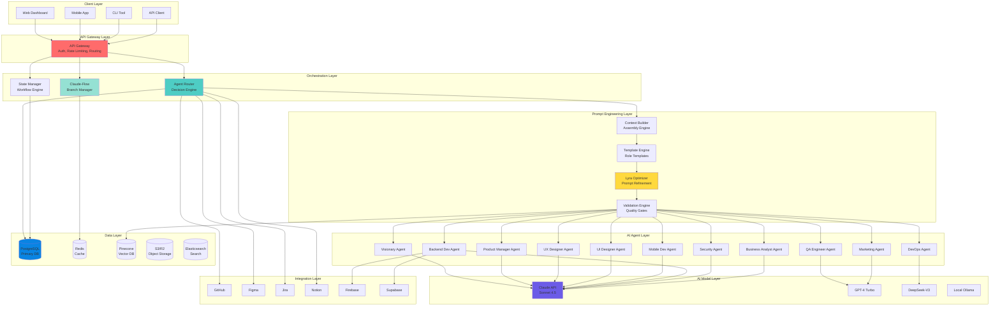
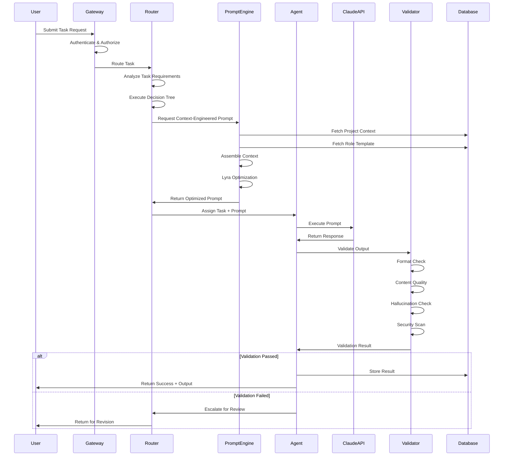
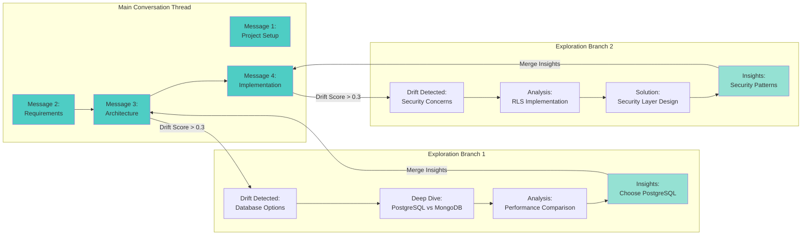
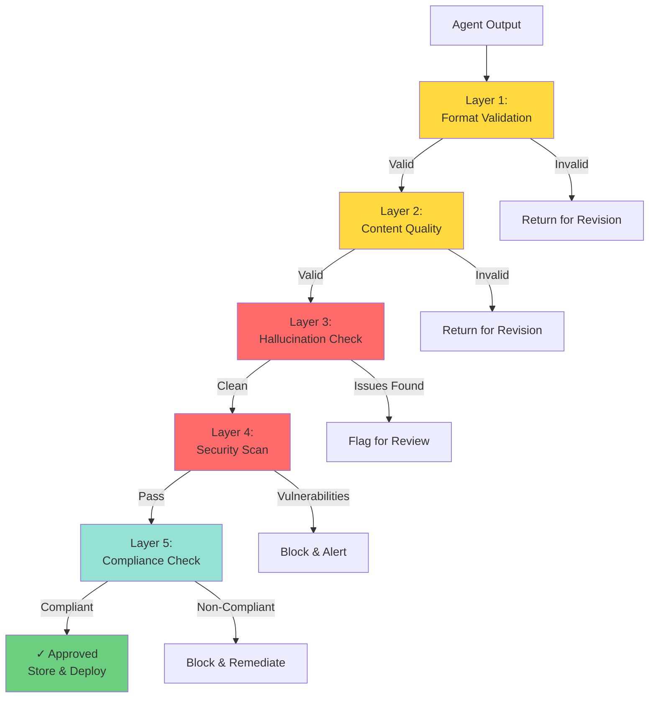
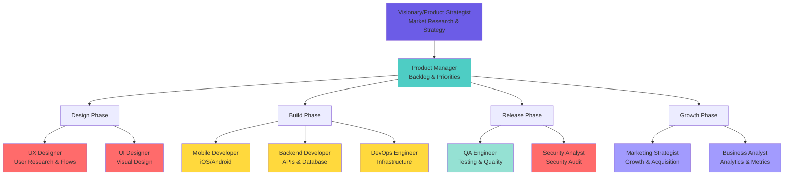
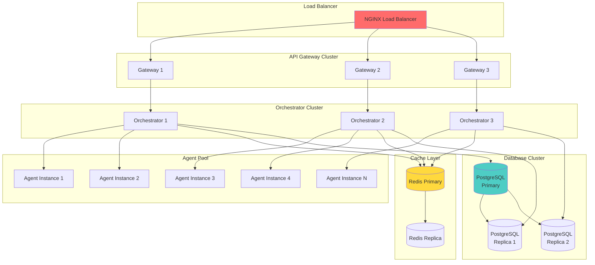
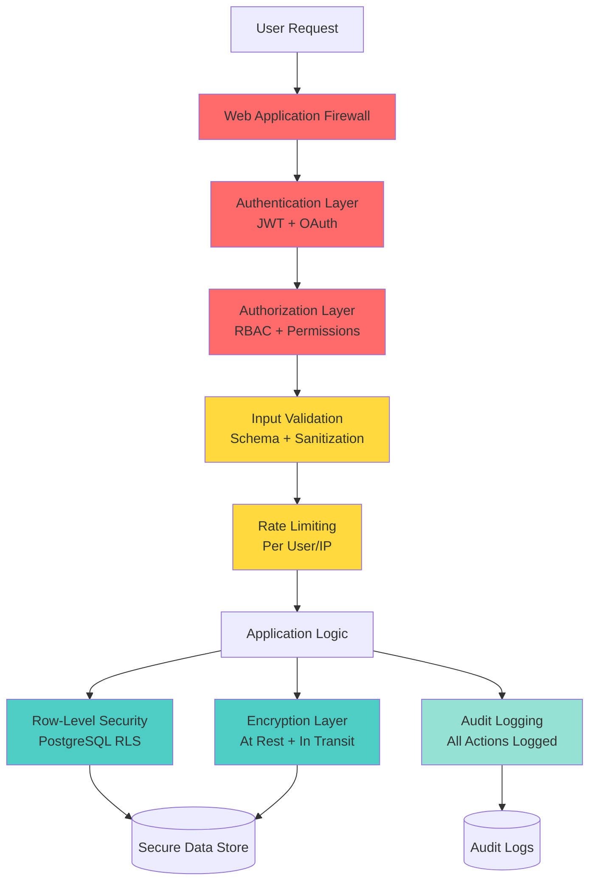
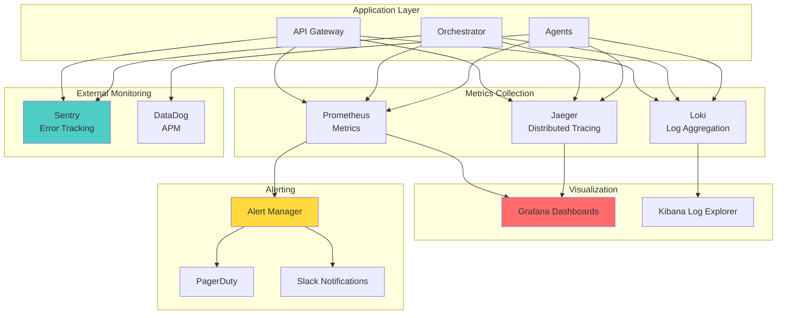

# System Architecture Diagrams
**Unified AI Orchestration System v3.0**

## 1. High-Level System Architecture

## 2. Data Flow Architecture

## 3. Claude-Flow Integration

## 4. Quality Validation Pipeline

## 5. Agent Role Hierarchy

## 6. Scalability Architecture

## 7. Security Architecture

## 8. Deployment Pipeline

```mermaid
graph LR
    CODE[Code Push] --> LINT[Linting<br/>ESLint/Prettier]
    
    LINT --> TEST[Unit Tests<br/>Jest/Vitest]
    
    TEST --> BUILD[Build<br/>TypeScript Compile]
    
    BUILD --> SECURITY_SCAN[Security Scan<br/>Snyk/OWASP]
    
    SECURITY_SCAN --> INTEGRATION[Integration Tests<br/>API Testing]
    
    INTEGRATION --> STAGING[Deploy to Staging]
    
    STAGING --> E2E[E2E Tests<br/>Playwright]
    
    E2E --> SMOKE[Smoke Tests<br/>Critical Paths]
    
    SMOKE --> CANARY[Canary Deploy<br/>10% Traffic]
    
    CANARY --> MONITOR[Monitor Metrics<br/>15 minutes]
    
    MONITOR -->|Success| PRODUCTION[Full Production<br/>Deploy]
    MONITOR -->|Failure| ROLLBACK[Automatic Rollback]
    
    PRODUCTION --> VERIFY[Post-Deploy<br/>Verification]
    
    style CODE fill:#4ecdc4
    style LINT fill:#ffd93d
    style TEST fill:#ffd93d
    style SECURITY_SCAN fill:#ff6b6b
    style CANARY fill:#95e1d3
    style PRODUCTION fill:#6bcf7f
    style ROLLBACK fill:#ff6b6b
```

## 9. Monitoring & Observability

---

## System Integration Points

### 1. External Integrations
- **GitHub**: Source code management, CI/CD triggers
- **Figma**: Design file synchronization, version tracking
- **Jira**: Task management, sprint planning
- **Notion**: Documentation, knowledge base
- **Firebase/Supabase**: Backend services, authentication

### 2. AI Model Integration
- **Claude API**: Primary reasoning, strategic thinking
- **GPT-4**: Specialized creative tasks, analysis
- **DeepSeek-V3**: Math and algorithmic optimization
- **Local Ollama**: Privacy-critical operations

### 3. Data Layer Integration
- **PostgreSQL**: Primary relational data with RLS
- **Redis**: Caching, session management, real-time data
- **Pinecone**: Vector embeddings for semantic search
- **S3/R2**: Object storage for artifacts and assets
- **Elasticsearch**: Full-text search across projects

---

## Key Architectural Decisions

### 1. **Microservices vs Monolith**
**Decision**: Hybrid approach
- **Core orchestration**: Monolithic for consistency
- **Agent workers**: Distributed microservices
- **Integrations**: Separate services for isolation

### 2. **Synchronous vs Asynchronous**
**Decision**: Mixed based on use case
- **User requests**: Synchronous (2-3s SLA)
- **Background tasks**: Asynchronous (job queues)
- **Integrations**: Asynchronous (webhooks)

### 3. **Database Strategy**
**Decision**: PostgreSQL with extensions
- **Primary data**: PostgreSQL with JSONB
- **Real-time**: Redis for caching
- **Search**: Elasticsearch for complex queries
- **Vectors**: Pinecone for embeddings

### 4. **Scaling Strategy**
**Decision**: Horizontal scaling with load balancing
- **Auto-scaling**: Based on CPU + queue depth
- **Load balancing**: Round-robin with health checks
- **Database**: Read replicas for scale

### 5. **Security Approach**
**Decision**: Defense in depth
- **Perimeter**: WAF + rate limiting
- **Application**: JWT auth + RBAC
- **Data**: RLS + encryption at rest
- **Audit**: Comprehensive logging

---

*For implementation details, see main unified_ai_orchestration_system.md document*
