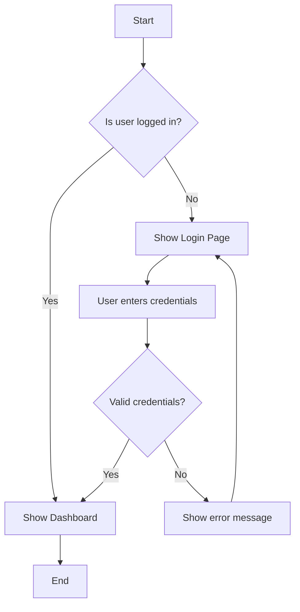
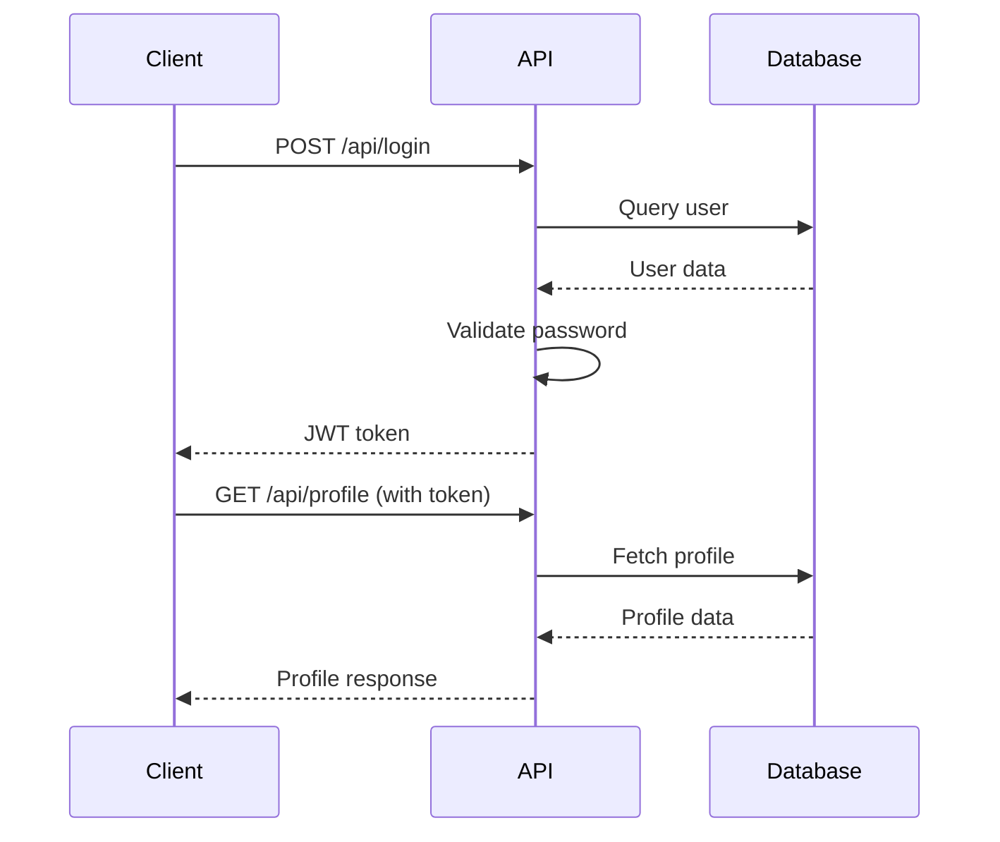

# Claude Features - Complete Guide

**Last Updated:** January 2025  
**Scope:** Artifacts, Projects, Memory, Vision, Computer Use, Extended Thinking

---

## TL;DR

Claude offers interactive artifacts (React, HTML, SVG), project workspaces (200K context), personal memory, vision (images/PDFs), computer control (beta), and extended thinking (Opus 4.1). Features sync across platforms with privacy controls.

---

## Artifacts

### What Are Artifacts?

**Artifacts** = Interactive, editable content created by Claude that lives alongside the conversation

**Analogy:** Think of artifacts like a shared whiteboard next to your chat - Claude can write code, diagrams, or documents that you can see, interact with, and modify in real-time.

### Supported Types

**Code:**
- React components (`.jsx`)
- HTML + CSS + JavaScript (`.html`)
- SVG graphics (`.svg`)
- Mermaid diagrams (`.mermaid`)

**Documents:**
- Markdown (`.md`)
- Plain text

### How to Use

**1. Request artifact:**
```
User: "Create a React component for a todo list"
Claude: [Generates interactive React component in artifact panel]
```

**2. Iterate:**
```
User: "Add a dark mode toggle"
Claude: [Updates artifact with new feature]
```

**3. Export:**
- Click "Copy" to get code
- Click "Download" to save file
- Click "Remix" to fork into new artifact

---

### React Artifacts

**Example: Todo List**
```jsx
import React, { useState } from 'react';

export default function TodoList() {
  const [todos, setTodos] = useState([]);
  const [input, setInput] = useState('');

  const addTodo = () => {
    if (input.trim()) {
      setTodos([...todos, { text: input, done: false }]);
      setInput('');
    }
  };

  return (
    <div className="p-4">
      <h1 className="text-2xl font-bold mb-4">My Todos</h1>
      <div className="flex gap-2 mb-4">
        <input
          type="text"
          value={input}
          onChange={(e) => setInput(e.target.value)}
          onKeyPress={(e) => e.key === 'Enter' && addTodo()}
          className="flex-1 p-2 border rounded"
        />
        <button
          onClick={addTodo}
          className="px-4 py-2 bg-blue-500 text-white rounded"
        >
          Add
        </button>
      </div>
      <ul className="space-y-2">
        {todos.map((todo, i) => (
          <li key={i} className="flex items-center gap-2">
            <input
              type="checkbox"
              checked={todo.done}
              onChange={() => {
                const newTodos = [...todos];
                newTodos[i].done = !newTodos[i].done;
                setTodos(newTodos);
              }}
            />
            <span className={todo.done ? 'line-through' : ''}>
              {todo.text}
            </span>
          </li>
        ))}
      </ul>
    </div>
  );
}
```

**Libraries Available:**
- React (with hooks)
- Tailwind CSS (utility classes)
- Lucide React (icons)
- Recharts (charts)
- D3.js

---

### HTML Artifacts

**Example: Interactive Calculator**
```html
<!DOCTYPE html>
<html>
<head>
  <style>
    body {
      font-family: Arial, sans-serif;
      display: flex;
      justify-content: center;
      align-items: center;
      height: 100vh;
      margin: 0;
      background: #f0f0f0;
    }
    .calculator {
      background: white;
      padding: 20px;
      border-radius: 10px;
      box-shadow: 0 4px 6px rgba(0,0,0,0.1);
    }
    .display {
      font-size: 2em;
      padding: 10px;
      text-align: right;
      background: #eee;
      border-radius: 5px;
      margin-bottom: 10px;
    }
    .buttons {
      display: grid;
      grid-template-columns: repeat(4, 1fr);
      gap: 10px;
    }
    button {
      padding: 20px;
      font-size: 1.2em;
      border: none;
      background: #4CAF50;
      color: white;
      border-radius: 5px;
      cursor: pointer;
    }
    button:hover {
      background: #45a049;
    }
  </style>
</head>
<body>
  <div class="calculator">
    <div class="display" id="display">0</div>
    <div class="buttons">
      <button onclick="appendNumber('7')">7</button>
      <button onclick="appendNumber('8')">8</button>
      <button onclick="appendNumber('9')">9</button>
      <button onclick="setOperation('/')">/</button>
      <!-- ... more buttons -->
    </div>
  </div>
  <script>
    let currentValue = '0';
    let previousValue = null;
    let operation = null;

    function appendNumber(num) {
      if (currentValue === '0') currentValue = num;
      else currentValue += num;
      updateDisplay();
    }

    function setOperation(op) {
      if (previousValue === null) {
        previousValue = currentValue;
        currentValue = '0';
        operation = op;
      }
    }

    function calculate() {
      if (previousValue && operation) {
        const a = parseFloat(previousValue);
        const b = parseFloat(currentValue);
        switch (operation) {
          case '+': currentValue = String(a + b); break;
          case '-': currentValue = String(a - b); break;
          case '*': currentValue = String(a * b); break;
          case '/': currentValue = String(a / b); break;
        }
        previousValue = null;
        operation = null;
        updateDisplay();
      }
    }

    function updateDisplay() {
      document.getElementById('display').textContent = currentValue;
    }
  </script>
</body>
</html>
```

---

### SVG Artifacts

**Example: Data Visualization**
```svg
<svg width="400" height="300" xmlns="http://www.w3.org/2000/svg">
  <rect width="400" height="300" fill="#f8f9fa"/>
  
  <!-- Bar chart -->
  <rect x="50" y="200" width="60" height="80" fill="#4CAF50"/>
  <rect x="130" y="150" width="60" height="130" fill="#2196F3"/>
  <rect x="210" y="180" width="60" height="100" fill="#FF9800"/>
  <rect x="290" y="120" width="60" height="160" fill="#F44336"/>
  
  <!-- Labels -->
  <text x="80" y="295" text-anchor="middle" font-size="14">Q1</text>
  <text x="160" y="295" text-anchor="middle" font-size="14">Q2</text>
  <text x="240" y="295" text-anchor="middle" font-size="14">Q3</text>
  <text x="320" y="295" text-anchor="middle" font-size="14">Q4</text>
  
  <!-- Title -->
  <text x="200" y="30" text-anchor="middle" font-size="20" font-weight="bold">
    Quarterly Revenue
  </text>
</svg>
```

---

### Mermaid Diagrams

**Example: Flowchart**


**Example: Sequence Diagram**


---

### Best Practices

**When to Use Artifacts:**
- ✅ Interactive demos, prototypes
- ✅ Data visualizations
- ✅ Reusable components
- ✅ Documents for export

**When NOT to Use Artifacts:**
- ❌ Simple code snippets (use inline code blocks)
- ❌ Explanations (use regular chat)
- ❌ Very large applications (break into multiple artifacts)

---

## Projects

### What Are Projects?

**Projects** = Dedicated workspaces with custom instructions, knowledge base, and isolated conversation history

**Analogy:** Like having a specialized assistant for each area of work - one for Python development, one for marketing copy, one for data analysis - each with its own context and preferences.

### Key Features

**Custom Instructions:**
```
Example for "Python Dev" project:
- You are an expert Python developer
- Use type hints and docstrings
- Follow PEP 8 style guide
- Prefer pytest for testing
- Use modern Python 3.12+ features
```

**Project Knowledge:**
- Upload documents (PDFs, code files, docs)
- Up to 200K tokens of context
- Automatically included in every conversation
- Examples: API docs, codebase, style guides

**Isolated History:**
- Conversations stay within project
- No cross-contamination between projects
- Clear separation of contexts

---

### Creating a Project

**1. Click "New Project"**

**2. Set up project:**
```
Name: "E-commerce Platform"

Custom Instructions:
You are a senior full-stack developer working on an e-commerce platform.
Stack: Next.js 15, TypeScript, Tailwind, Supabase, Stripe.
Always consider: scalability, security, and user experience.

Knowledge:
- Upload: API documentation.pdf
- Upload: design-system.md
- Upload: /src folder (codebase)
```

**3. Start chatting:**
```
User: "Add a cart feature"
Claude: [Has full context of codebase, knows tech stack, follows conventions]
```

---

### Project Templates

**Software Development:**
```
Custom Instructions:
- Language/framework expertise
- Code style preferences
- Testing approach
- Documentation standards

Knowledge:
- Codebase files
- API documentation
- Architecture diagrams
```

**Content Creation:**
```
Custom Instructions:
- Brand voice and tone
- Target audience
- Content guidelines

Knowledge:
- Brand guidelines PDF
- Previous articles
- Style guide
```

**Data Analysis:**
```
Custom Instructions:
- Statistical methods to use
- Visualization preferences
- Report format

Knowledge:
- Dataset files (CSV, JSON)
- Domain documentation
- Analysis templates
```

---

### Collaboration (Pro/Enterprise)

**Team Projects:**
- Share projects with teammates
- Everyone has same context
- Conversations stay separate
- Update knowledge centrally

**Access Control:**
- Owner: Full control
- Editor: Can chat and edit knowledge
- Viewer: Can view conversations only

---

## Memory

### What Is Memory?

**Memory** = Personal preferences and context that Claude remembers across ALL conversations (not just within a project)

**Analogy:** Like getting to know a colleague over time - they remember you're a Python developer, prefer concise answers, and are working in healthcare, without you having to re-introduce yourself each time.

### How It Works

**Automatic Learning:**
```
You: "I'm a Python developer working in healthcare"
Claude: [Saves to memory]

Next day, different conversation:
You: "Help me write some code"
Claude: [Responds with Python examples, healthcare context]
```

**Explicit Memory:**
```
You: "Remember that I prefer TypeScript over JavaScript"
Claude: "I'll remember that you prefer TypeScript over JavaScript for future conversations."
```

**View Memory:**
```
Settings → Memory → View what Claude remembers
```

---

### What Claude Remembers

**Professional Context:**
- Programming languages
- Job role / industry
- Common tools and workflows
- Technical preferences

**Communication Style:**
- Verbosity (concise vs detailed)
- Format preferences (bullet points vs paragraphs)
- Tone (formal vs casual)

**Personal Context:**
- Timezone / location
- Common project types
- Recurring tasks

**What Claude DOESN'T Remember:**
- Sensitive information (passwords, API keys, PII)
- Specific conversation content
- Anything you ask to forget

---

### Managing Memory

**View Memory:**
```
Settings → Memory → View memories
```

**Edit Memory:**
```
Click on specific memory → Edit or delete
```

**Clear Memory:**
```
Settings → Memory → Clear all memories
```

**Disable Memory:**
```
Settings → Memory → Turn off memory
```

### Privacy

- **Opt-in:** Disabled by default
- **User control:** View, edit, delete anytime
- **Not for training:** Never used to train models
- **Scope:** Personal only, not shared with team

---

## Vision

### Image Understanding

**Supported Formats:**
- PNG, JPEG, WebP, GIF (non-animated)
- Max size: 5MB per image
- Max resolution: 8000×8000 pixels
- Max images: 20 per request (claude.ai: 5 free, 10 Pro)

**Use Cases:**
- Screenshot analysis
- Chart/graph interpretation
- Diagram understanding
- Code from mockups
- Photo descriptions
- OCR (text extraction)

**Example:**
```
User: [Uploads screenshot of error message]
"What's causing this error?"

Claude: "The error shows a null pointer exception on line 42.
The variable 'userData' is null when you try to access
'userData.email'. Add a null check before accessing properties."
```

---

### PDF Analysis

**Capabilities:**
- Text extraction (native + OCR)
- Image processing (embedded images)
- Multi-page analysis
- Table understanding
- Form extraction

**Limits:**
- Max size: 32MB
- Max pages: 100
- Counts toward 200K token limit

**Example:**
```
User: [Uploads 50-page financial report PDF]
"Summarize the key findings and extract revenue figures"

Claude: "Key findings:
1. Revenue up 23% YoY ($45.2M → $55.7M)
2. Operating margin improved from 12% to 18%
3. Customer acquisition cost decreased by 15%
...
[Detailed summary with page references]"
```

---

### Charts & Diagrams

**Capabilities:**
- Bar charts, line graphs, pie charts
- Flowcharts, org charts
- Architecture diagrams
- UI mockups
- Handwritten notes

**Example:**
```
User: [Uploads chart image]
"What trends do you see?"

Claude: "The chart shows quarterly sales from Q1-Q4 2024:
- Strong upward trend (Q1: $2M → Q4: $3.5M)
- Largest jump in Q2 (+40%)
- Steady growth in Q3-Q4 (~15% per quarter)
- Seasonal pattern suggests Q4 peak is typical"
```

---

## Computer Use (Beta)

### What Is Computer Use?

**Computer Use** = Claude can see your screen and control your computer through keyboard/mouse actions

**Status:** Beta, API-only (not in claude.ai or Desktop)  
**Model:** Claude Sonnet 4.5 only  
**Platform:** macOS, Windows, Linux

### Capabilities

**Actions:**
- **Mouse:** Click, double-click, right-click, drag, move
- **Keyboard:** Type text, press keys, shortcuts (Cmd+C, Ctrl+V)
- **Screen:** Take screenshots, read screen content
- **Scrolling:** Up, down, left, right

**Use Cases:**
- Browser automation (form filling, web scraping)
- App testing (UI interaction, flow validation)
- Data entry (spreadsheet filling, database updates)
- Research (multi-tab navigation, content aggregation)

---

### How It Works

**1. Claude sees screen:**
```python
# Take screenshot
screenshot = capture_screen()
# Send to Claude
```

**2. Claude decides action:**
```python
# Claude returns:
{
  "action": "left_click",
  "coordinate": [450, 300]
}
```

**3. Execute action:**
```python
# Click at coordinates
click(450, 300)
```

**4. Update screen:**
```python
# Capture new state
new_screenshot = capture_screen()
# Send to Claude for next action
```

---

### Safety & Limitations

**Safety:**
- Always requires explicit user approval
- Runs in sandboxed environment
- No access to clipboard or sensitive apps
- Can be terminated instantly

**Limitations:**
- API-only (no consumer UI yet)
- Requires good lighting (for screenshots)
- Works best with clear UI elements
- May struggle with complex multi-step workflows

**Best Practices:**
- Start with simple tasks
- Provide clear instructions
- Monitor execution
- Have kill switch ready
- Test in safe environment first

---

## Extended Thinking (Opus 4.1)

### What Is Extended Thinking?

**Extended Thinking** = Claude's internal reasoning process made visible, with up to 64K tokens of "thinking space"

**Only Available:** Claude Opus 4.1  
**Output Limit:** 64K tokens (vs 8K normal)

### How to Enable

**API:**
```python
import anthropic

client = anthropic.Anthropic()

response = client.messages.create(
    model="claude-opus-4.1-20250107",
    max_tokens=64000,  # Enable extended output
    thinking={
        "type": "enabled",
        "budget_tokens": 10000  # Optional budget control
    },
    messages=[{
        "role": "user",
        "content": "Prove the Riemann hypothesis"
    }]
)

# Response includes thinking blocks
for block in response.content:
    if block.type == "thinking":
        print("THINKING:", block.thinking)
    elif block.type == "text":
        print("RESPONSE:", block.text)
```

---

### Use Cases

**Complex Math:**
- Multi-step proofs
- Competition problems
- Research-level math

**Strategic Planning:**
- Multi-stakeholder analysis
- Long-term forecasting
- Risk assessment

**Research:**
- Literature synthesis
- Hypothesis generation
- Methodology design

**Legal Analysis:**
- Case law review
- Contract analysis
- Regulatory compliance

---

### Pricing

**Thinking tokens = Output tokens**
- Same rate: $75 per 1M tokens
- Budget control to prevent runaway costs
- Adaptive: Claude uses what's needed

**Example:**
```
Input: 1K tokens ($0.015)
Thinking: 5K tokens ($0.375)
Output: 2K tokens ($0.150)
Total: $0.54
```

---

## CLAIMS / COUNTEREXAMPLE / CONTRADICTIONS

**CLAIM:** Projects support up to 200K tokens of knowledge  
**SOURCE:** [claude.ai/help/projects](https://claude.ai/help/projects)  
**STATUS:** Verified January 2025

**CLAIM:** Memory is opt-in and never used for training  
**SOURCE:** [anthropic.com/privacy](https://anthropic.com/privacy)  
**STATUS:** Verified January 2025

**CLAIM:** Computer Use is Claude Sonnet 4.5 only, API-only  
**SOURCE:** [docs.anthropic.com/computer-use](https://docs.anthropic.com/computer-use)  
**STATUS:** Verified January 2025 (Beta)

**CLAIM:** Extended Thinking is Opus 4.1 only with 64K output limit  
**SOURCE:** [anthropic.com/claude/opus-4-1](https://anthropic.com/claude/opus-4-1)  
**STATUS:** Verified January 2025

**COUNTEREXAMPLE:** Artifacts NOT available in mobile apps - web and desktop only

**CONTRADICTION:** Free tier limits vary by demand - no fixed daily usage guarantee
