# Architecture Migration Guide

> Comprehensive patterns and strategies for transforming system architectures at scale.

## Table of Contents

1. [Overview](#overview)
2. [Monolith to Microservices](#monolith-to-microservices)
3. [REST to GraphQL](#rest-to-graphql)
4. [Synchronous to Event-Driven](#synchronous-to-event-driven)
5. [Single-Tenant to Multi-Tenant](#single-tenant-to-multi-tenant)
6. [API Versioning Strategies](#api-versioning-strategies)
7. [Cross-Cutting Concerns](#cross-cutting-concerns)
8. [Testing Strategies](#testing-strategies)
9. [Deployment and Rollback](#deployment-and-rollback)
10. [Team Organization](#team-organization)

---

## Overview

Architecture migrations are among the most complex undertakings in software engineering. This guide provides battle-tested patterns from successful migrations at companies like Netflix, Amazon, Uber, and Spotify.

### Key Principles

1. **Incremental Migration**: Never attempt a big-bang rewrite
2. **Measure Everything**: Establish baselines before migration
3. **Reversibility**: Design for rollback at every step
4. **Business Continuity**: Zero-downtime migrations are non-negotiable

### Migration Readiness Checklist

```markdown
## Pre-Migration Assessment

- [ ] Current architecture documented
- [ ] Performance baselines established
- [ ] Dependencies mapped
- [ ] Team skills assessed
- [ ] Business stakeholders aligned
- [ ] Rollback strategy defined
- [ ] Success metrics identified
- [ ] Timeline realistic (multiply estimate by 3)
```

---

## Monolith to Microservices

### When to Migrate

**Migrate when you have:**
- Team scaling issues (>50 developers on monolith)
- Deployment frequency bottlenecks
- Specific components with different scaling needs
- Clear domain boundaries

**Do NOT migrate if:**
- Small team (<10 developers)
- Unclear domain boundaries
- Trying to fix bad code (microservices won't help)
- No DevOps maturity

### Domain-Driven Design for Service Boundaries

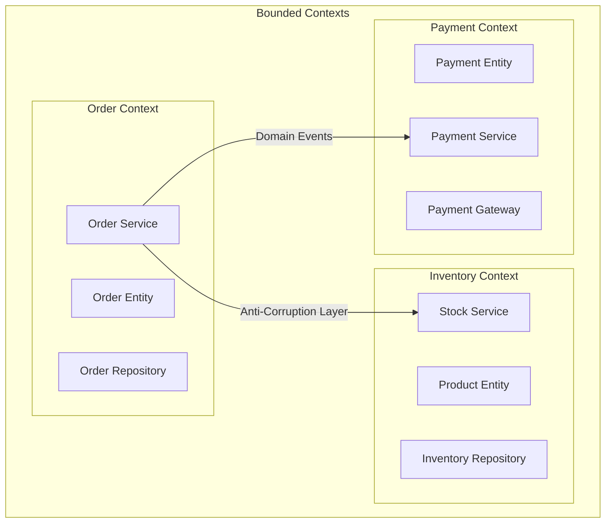

#### Identifying Bounded Contexts

```python
# Example: Domain Event that crosses boundaries
from dataclasses import dataclass
from datetime import datetime
from typing import Optional
import uuid

@dataclass(frozen=True)
class DomainEvent:
    """Base class for all domain events."""
    event_id: str
    occurred_at: datetime
    aggregate_id: str

    def __post_init__(self):
        object.__setattr__(self, 'event_id', str(uuid.uuid4()))
        object.__setattr__(self, 'occurred_at', datetime.utcnow())

@dataclass(frozen=True)
class OrderPlacedEvent(DomainEvent):
    """Event emitted when order is placed - consumed by Inventory & Payment."""
    customer_id: str
    items: tuple  # Immutable list of (product_id, quantity)
    total_amount: float
    currency: str = "USD"

@dataclass(frozen=True)
class PaymentCompletedEvent(DomainEvent):
    """Event emitted when payment succeeds - consumed by Order & Fulfillment."""
    order_id: str
    payment_method: str
    transaction_id: str
    amount: float

# Anti-Corruption Layer Example
class InventoryAntiCorruptionLayer:
    """
    Translates between Order context and Inventory context.
    Prevents Inventory domain concepts from leaking into Order domain.
    """

    def __init__(self, inventory_client):
        self._client = inventory_client

    def check_availability(self, order_items: list) -> dict:
        """Translate order items to inventory query."""
        # Order context uses (product_id, quantity)
        # Inventory context uses SKU and stock units
        inventory_request = [
            {"sku": self._to_sku(item.product_id), "units": item.quantity}
            for item in order_items
        ]

        response = self._client.check_stock(inventory_request)

        # Translate back to order context
        return {
            item.product_id: response.get(self._to_sku(item.product_id), {}).get("available", False)
            for item in order_items
        }

    def _to_sku(self, product_id: str) -> str:
        """Map product ID to inventory SKU."""
        # This mapping isolates the contexts
        return f"SKU-{product_id}"
```

### The Strangler Fig Pattern

The safest approach for incremental migration:

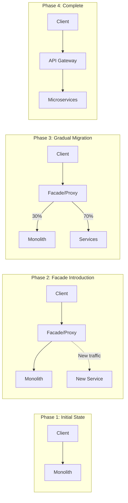

#### Implementation with Feature Flags

```typescript
// strangler-facade.ts
import { FeatureFlags } from './feature-flags';

interface OrderRequest {
  customerId: string;
  items: Array<{ productId: string; quantity: number }>;
}

interface OrderResponse {
  orderId: string;
  status: string;
  estimatedDelivery: Date;
}

class StranglerFacade {
  constructor(
    private monolith: MonolithClient,
    private orderService: OrderServiceClient,
    private featureFlags: FeatureFlags,
    private metrics: MetricsClient
  ) {}

  async createOrder(request: OrderRequest): Promise<OrderResponse> {
    const startTime = Date.now();
    const useNewService = await this.featureFlags.isEnabled(
      'use_order_microservice',
      { customerId: request.customerId }
    );

    try {
      if (useNewService) {
        // Route to new microservice
        const response = await this.orderService.createOrder(request);
        this.metrics.increment('order.microservice.success');
        return response;
      } else {
        // Route to monolith
        const response = await this.monolith.createOrder(request);
        this.metrics.increment('order.monolith.success');
        return response;
      }
    } catch (error) {
      this.metrics.increment(
        useNewService ? 'order.microservice.error' : 'order.monolith.error'
      );

      // Fallback to monolith if new service fails
      if (useNewService && this.featureFlags.isEnabled('order_service_fallback')) {
        console.warn('Falling back to monolith for order creation');
        return this.monolith.createOrder(request);
      }

      throw error;
    } finally {
      this.metrics.timing('order.latency', Date.now() - startTime, {
        service: useNewService ? 'microservice' : 'monolith'
      });
    }
  }
}

// Gradual rollout configuration
const rolloutConfig = {
  phases: [
    { percentage: 1, duration: '1 week', criteria: 'internal users only' },
    { percentage: 5, duration: '1 week', criteria: 'low-value orders' },
    { percentage: 25, duration: '2 weeks', criteria: 'all non-enterprise' },
    { percentage: 50, duration: '2 weeks', criteria: 'all users' },
    { percentage: 100, duration: 'permanent', criteria: 'complete migration' }
  ],
  rollbackTriggers: [
    { metric: 'error_rate', threshold: 0.01, window: '5 minutes' },
    { metric: 'latency_p99', threshold: 2000, window: '5 minutes' },
    { metric: 'order_completion_rate', threshold: 0.95, window: '1 hour' }
  ]
};
```

### Database Decomposition Strategies

#### Pattern 1: Shared Database (Temporary)

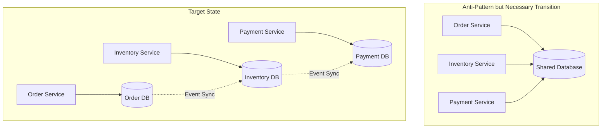

#### Pattern 2: Database View Abstraction

```sql
-- Step 1: Create service-specific views as abstraction layer
CREATE VIEW order_service.orders_view AS
SELECT
    o.id,
    o.customer_id,
    o.status,
    o.created_at,
    o.total_amount
FROM legacy_schema.orders o
WHERE o.deleted_at IS NULL;

-- Step 2: Create the new service table
CREATE TABLE order_service.orders (
    id UUID PRIMARY KEY DEFAULT gen_random_uuid(),
    customer_id UUID NOT NULL,
    status VARCHAR(50) NOT NULL DEFAULT 'pending',
    created_at TIMESTAMP WITH TIME ZONE DEFAULT NOW(),
    total_amount DECIMAL(10,2) NOT NULL,
    version INTEGER NOT NULL DEFAULT 1,
    CONSTRAINT valid_status CHECK (status IN ('pending', 'confirmed', 'shipped', 'delivered', 'cancelled'))
);

-- Step 3: Data migration with dual-write verification
CREATE OR REPLACE FUNCTION sync_order_to_new_table()
RETURNS TRIGGER AS $$
BEGIN
    INSERT INTO order_service.orders (id, customer_id, status, created_at, total_amount)
    VALUES (NEW.id, NEW.customer_id, NEW.status, NEW.created_at, NEW.total_amount)
    ON CONFLICT (id) DO UPDATE SET
        status = EXCLUDED.status,
        total_amount = EXCLUDED.total_amount,
        version = order_service.orders.version + 1;
    RETURN NEW;
END;
$$ LANGUAGE plpgsql;

CREATE TRIGGER order_sync_trigger
AFTER INSERT OR UPDATE ON legacy_schema.orders
FOR EACH ROW EXECUTE FUNCTION sync_order_to_new_table();
```

#### Pattern 3: Change Data Capture (CDC)

```yaml
# Debezium CDC Configuration
apiVersion: kafka.strimzi.io/v1beta2
kind: KafkaConnect
metadata:
  name: order-cdc-connect
spec:
  replicas: 2
  bootstrapServers: kafka-cluster:9092
  config:
    group.id: order-cdc-group
    offset.storage.topic: connect-offsets
    config.storage.topic: connect-configs
    status.storage.topic: connect-status
---
# Debezium PostgreSQL Connector
apiVersion: kafka.strimzi.io/v1beta2
kind: KafkaConnector
metadata:
  name: order-postgres-connector
spec:
  class: io.debezium.connector.postgresql.PostgresConnector
  tasksMax: 1
  config:
    database.hostname: postgres-monolith
    database.port: 5432
    database.user: debezium
    database.password: ${DEBEZIUM_PASSWORD}
    database.dbname: monolith
    database.server.name: orders
    table.include.list: legacy_schema.orders,legacy_schema.order_items
    plugin.name: pgoutput
    slot.name: order_slot
    publication.name: order_publication
    transforms: unwrap
    transforms.unwrap.type: io.debezium.transforms.ExtractNewRecordState
```

```python
# CDC Consumer for Order Service
from kafka import KafkaConsumer
import json

class OrderCDCConsumer:
    def __init__(self, bootstrap_servers: list, order_repository):
        self.consumer = KafkaConsumer(
            'orders.legacy_schema.orders',
            bootstrap_servers=bootstrap_servers,
            value_deserializer=lambda m: json.loads(m.decode('utf-8')),
            group_id='order-service-cdc',
            auto_offset_reset='earliest',
            enable_auto_commit=False
        )
        self.order_repository = order_repository

    def process_changes(self):
        for message in self.consumer:
            try:
                change_event = message.value
                operation = change_event.get('op')

                if operation == 'c':  # Create
                    self._handle_create(change_event['after'])
                elif operation == 'u':  # Update
                    self._handle_update(change_event['before'], change_event['after'])
                elif operation == 'd':  # Delete
                    self._handle_delete(change_event['before'])

                self.consumer.commit()
            except Exception as e:
                self._handle_error(message, e)

    def _handle_create(self, record: dict):
        order = Order(
            id=record['id'],
            customer_id=record['customer_id'],
            status=record['status'],
            total_amount=record['total_amount']
        )
        self.order_repository.save(order)

    def _handle_update(self, before: dict, after: dict):
        order = self.order_repository.find_by_id(after['id'])
        if order:
            order.status = after['status']
            order.total_amount = after['total_amount']
            self.order_repository.save(order)
```

### Inter-Service Communication

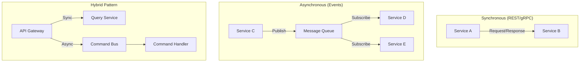

#### gRPC Service Definition

```protobuf
// order_service.proto
syntax = "proto3";

package order.v1;

import "google/protobuf/timestamp.proto";
import "google/protobuf/empty.proto";

option go_package = "github.com/company/order-service/proto/order/v1";

service OrderService {
  // Synchronous operations
  rpc GetOrder(GetOrderRequest) returns (Order);
  rpc CreateOrder(CreateOrderRequest) returns (Order);

  // Streaming for bulk operations
  rpc StreamOrders(StreamOrdersRequest) returns (stream Order);

  // Bidirectional streaming for real-time updates
  rpc WatchOrders(stream WatchOrdersRequest) returns (stream OrderUpdate);
}

message Order {
  string id = 1;
  string customer_id = 2;
  OrderStatus status = 3;
  repeated OrderItem items = 4;
  Money total_amount = 5;
  google.protobuf.Timestamp created_at = 6;
  google.protobuf.Timestamp updated_at = 7;
  int32 version = 8; // Optimistic locking
}

message OrderItem {
  string product_id = 1;
  int32 quantity = 2;
  Money unit_price = 3;
}

message Money {
  string currency_code = 1; // ISO 4217
  int64 units = 2;          // Whole units
  int32 nanos = 3;          // Nano units (10^-9)
}

enum OrderStatus {
  ORDER_STATUS_UNSPECIFIED = 0;
  ORDER_STATUS_PENDING = 1;
  ORDER_STATUS_CONFIRMED = 2;
  ORDER_STATUS_SHIPPED = 3;
  ORDER_STATUS_DELIVERED = 4;
  ORDER_STATUS_CANCELLED = 5;
}

message GetOrderRequest {
  string order_id = 1;
}

message CreateOrderRequest {
  string customer_id = 1;
  repeated OrderItem items = 2;
  string idempotency_key = 3; // Prevent duplicate orders
}

message StreamOrdersRequest {
  string customer_id = 1;
  OrderStatus status_filter = 2;
  int32 page_size = 3;
}

message WatchOrdersRequest {
  repeated string order_ids = 1;
}

message OrderUpdate {
  string order_id = 1;
  OrderStatus previous_status = 2;
  OrderStatus current_status = 3;
  google.protobuf.Timestamp updated_at = 4;
}
```

#### Message Queue Patterns

```typescript
// Event-driven communication with RabbitMQ/AMQP
import { Channel, Connection, connect } from 'amqplib';

interface DomainEvent {
  eventId: string;
  eventType: string;
  aggregateId: string;
  aggregateType: string;
  payload: unknown;
  metadata: {
    correlationId: string;
    causationId: string;
    timestamp: string;
    version: number;
  };
}

class EventBus {
  private connection: Connection;
  private channel: Channel;
  private exchangeName = 'domain.events';

  async initialize(): Promise<void> {
    this.connection = await connect(process.env.RABBITMQ_URL);
    this.channel = await this.connection.createChannel();

    // Declare topic exchange for flexible routing
    await this.channel.assertExchange(this.exchangeName, 'topic', {
      durable: true
    });

    // Dead letter exchange for failed messages
    await this.channel.assertExchange('domain.events.dlx', 'topic', {
      durable: true
    });
  }

  async publish(event: DomainEvent): Promise<void> {
    const routingKey = `${event.aggregateType}.${event.eventType}`;
    const message = Buffer.from(JSON.stringify(event));

    this.channel.publish(this.exchangeName, routingKey, message, {
      persistent: true,
      messageId: event.eventId,
      correlationId: event.metadata.correlationId,
      timestamp: Date.now(),
      headers: {
        'x-event-type': event.eventType,
        'x-aggregate-type': event.aggregateType
      }
    });
  }

  async subscribe(
    queueName: string,
    routingPatterns: string[],
    handler: (event: DomainEvent) => Promise<void>
  ): Promise<void> {
    // Create queue with dead letter configuration
    await this.channel.assertQueue(queueName, {
      durable: true,
      deadLetterExchange: 'domain.events.dlx',
      deadLetterRoutingKey: `${queueName}.dlq`,
      arguments: {
        'x-message-ttl': 86400000, // 24 hours
        'x-max-retries': 3
      }
    });

    // Bind queue to exchange with routing patterns
    for (const pattern of routingPatterns) {
      await this.channel.bindQueue(queueName, this.exchangeName, pattern);
    }

    // Consume with manual acknowledgment
    this.channel.consume(queueName, async (msg) => {
      if (!msg) return;

      try {
        const event: DomainEvent = JSON.parse(msg.content.toString());
        await handler(event);
        this.channel.ack(msg);
      } catch (error) {
        const retryCount = (msg.properties.headers?.['x-retry-count'] || 0) + 1;

        if (retryCount <= 3) {
          // Retry with exponential backoff
          setTimeout(() => {
            this.channel.nack(msg, false, true);
          }, Math.pow(2, retryCount) * 1000);
        } else {
          // Send to dead letter queue
          this.channel.nack(msg, false, false);
        }
      }
    });
  }
}

// Usage: Order Service publishes, Inventory Service subscribes
const eventBus = new EventBus();

// Publisher (Order Service)
await eventBus.publish({
  eventId: uuid(),
  eventType: 'OrderPlaced',
  aggregateId: order.id,
  aggregateType: 'Order',
  payload: {
    customerId: order.customerId,
    items: order.items,
    totalAmount: order.totalAmount
  },
  metadata: {
    correlationId: requestContext.correlationId,
    causationId: requestContext.requestId,
    timestamp: new Date().toISOString(),
    version: 1
  }
});

// Subscriber (Inventory Service)
await eventBus.subscribe(
  'inventory-service.order-events',
  ['Order.OrderPlaced', 'Order.OrderCancelled'],
  async (event) => {
    if (event.eventType === 'OrderPlaced') {
      await inventoryService.reserveStock(event.payload.items);
    } else if (event.eventType === 'OrderCancelled') {
      await inventoryService.releaseStock(event.payload.items);
    }
  }
);
```

---

## REST to GraphQL

### Migration Strategy

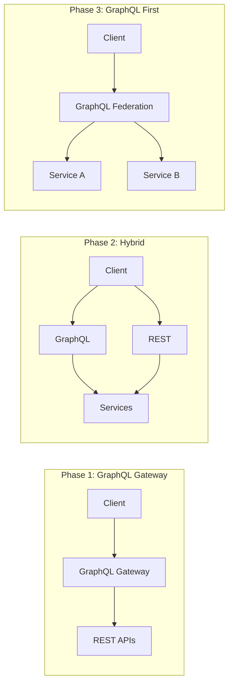

### GraphQL Federation Schema

```graphql
# Gateway Schema (Apollo Federation)
# user-service/schema.graphql
extend schema @link(url: "https://specs.apollo.dev/federation/v2.0", import: ["@key", "@shareable", "@external", "@requires"])

type User @key(fields: "id") {
  id: ID!
  email: String!
  name: String!
  createdAt: DateTime!
}

type Query {
  user(id: ID!): User
  users(first: Int, after: String): UserConnection!
}

# order-service/schema.graphql
extend schema @link(url: "https://specs.apollo.dev/federation/v2.0", import: ["@key", "@shareable", "@external", "@requires"])

type Order @key(fields: "id") {
  id: ID!
  status: OrderStatus!
  items: [OrderItem!]!
  totalAmount: Money!
  customer: User! # Reference to User service
  createdAt: DateTime!
}

type OrderItem {
  product: Product! # Reference to Product service
  quantity: Int!
  unitPrice: Money!
}

# Extend User type from user-service
extend type User @key(fields: "id") {
  id: ID! @external
  orders(first: Int, after: String, status: OrderStatus): OrderConnection!
}

type Query {
  order(id: ID!): Order
  orders(customerId: ID, status: OrderStatus, first: Int, after: String): OrderConnection!
}

type Mutation {
  createOrder(input: CreateOrderInput!): CreateOrderPayload!
  cancelOrder(id: ID!): CancelOrderPayload!
}

input CreateOrderInput {
  items: [OrderItemInput!]!
  shippingAddress: AddressInput!
  idempotencyKey: String!
}

type CreateOrderPayload {
  order: Order
  errors: [Error!]
}
```

### REST to GraphQL Resolver Mapping

```typescript
// Wrapping existing REST APIs with GraphQL resolvers
import { RESTDataSource } from '@apollo/datasource-rest';

class OrdersAPI extends RESTDataSource {
  override baseURL = process.env.ORDER_SERVICE_URL;

  async getOrder(id: string): Promise<Order> {
    return this.get(`/orders/${id}`);
  }

  async getOrdersByCustomer(
    customerId: string,
    params: { status?: string; page?: number; limit?: number }
  ): Promise<PaginatedOrders> {
    return this.get('/orders', {
      params: {
        customer_id: customerId,
        status: params.status,
        page: params.page || 1,
        limit: params.limit || 20
      }
    });
  }

  async createOrder(input: CreateOrderInput): Promise<Order> {
    return this.post('/orders', {
      body: {
        items: input.items,
        shipping_address: input.shippingAddress,
        idempotency_key: input.idempotencyKey
      }
    });
  }
}

// GraphQL Resolvers
const resolvers = {
  Query: {
    order: async (_, { id }, { dataSources }) => {
      return dataSources.ordersAPI.getOrder(id);
    },
    orders: async (_, { customerId, status, first, after }, { dataSources }) => {
      const page = after ? decodeCursor(after) + 1 : 1;
      const result = await dataSources.ordersAPI.getOrdersByCustomer(customerId, {
        status,
        page,
        limit: first || 20
      });

      return {
        edges: result.orders.map((order, index) => ({
          node: order,
          cursor: encodeCursor(page * (first || 20) + index)
        })),
        pageInfo: {
          hasNextPage: result.hasMore,
          endCursor: encodeCursor((page + 1) * (first || 20))
        },
        totalCount: result.total
      };
    }
  },

  // Federation resolver for User.orders
  User: {
    orders: async (user, { first, after, status }, { dataSources }) => {
      return dataSources.ordersAPI.getOrdersByCustomer(user.id, {
        status,
        page: after ? decodeCursor(after) + 1 : 1,
        limit: first || 20
      });
    }
  },

  // Reference resolver for federation
  Order: {
    __resolveReference: async (reference, { dataSources }) => {
      return dataSources.ordersAPI.getOrder(reference.id);
    },
    customer: (order) => {
      // Return reference for User service to resolve
      return { __typename: 'User', id: order.customerId };
    }
  },

  Mutation: {
    createOrder: async (_, { input }, { dataSources }) => {
      try {
        const order = await dataSources.ordersAPI.createOrder(input);
        return { order, errors: null };
      } catch (error) {
        return {
          order: null,
          errors: [{ message: error.message, code: error.code }]
        };
      }
    }
  }
};
```

---

## Synchronous to Event-Driven

### Event Sourcing Implementation

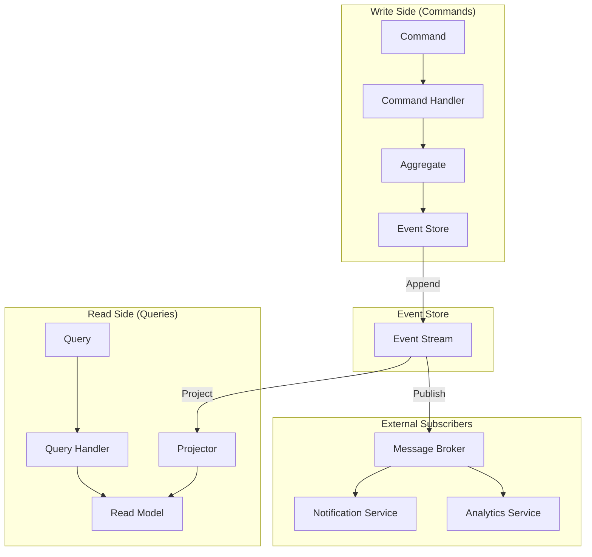

```python
# Event Sourcing with Python
from abc import ABC, abstractmethod
from dataclasses import dataclass, field
from datetime import datetime
from typing import List, Type, TypeVar, Generic
import json
import uuid

# Domain Events
@dataclass(frozen=True)
class Event:
    event_id: str = field(default_factory=lambda: str(uuid.uuid4()))
    timestamp: datetime = field(default_factory=datetime.utcnow)
    version: int = 1

@dataclass(frozen=True)
class OrderCreated(Event):
    order_id: str
    customer_id: str
    items: tuple

@dataclass(frozen=True)
class OrderItemAdded(Event):
    order_id: str
    product_id: str
    quantity: int
    unit_price: float

@dataclass(frozen=True)
class OrderConfirmed(Event):
    order_id: str
    confirmed_at: datetime

@dataclass(frozen=True)
class OrderShipped(Event):
    order_id: str
    tracking_number: str
    carrier: str

# Aggregate
T = TypeVar('T', bound='Aggregate')

class Aggregate(ABC):
    def __init__(self):
        self._uncommitted_events: List[Event] = []
        self._version: int = 0

    @abstractmethod
    def apply(self, event: Event) -> None:
        """Apply event to update aggregate state."""
        pass

    def load_from_history(self, events: List[Event]) -> None:
        """Reconstruct aggregate from event history."""
        for event in events:
            self.apply(event)
            self._version += 1

    def _raise_event(self, event: Event) -> None:
        """Raise new event and apply it."""
        self._uncommitted_events.append(event)
        self.apply(event)

    def get_uncommitted_events(self) -> List[Event]:
        return self._uncommitted_events.copy()

    def mark_events_as_committed(self) -> None:
        self._uncommitted_events.clear()

class Order(Aggregate):
    def __init__(self):
        super().__init__()
        self.id: str = None
        self.customer_id: str = None
        self.items: dict = {}
        self.status: str = None
        self.tracking_number: str = None

    @classmethod
    def create(cls, order_id: str, customer_id: str, items: List[dict]) -> 'Order':
        order = cls()
        order._raise_event(OrderCreated(
            order_id=order_id,
            customer_id=customer_id,
            items=tuple((item['product_id'], item['quantity'], item['price']) for item in items)
        ))
        return order

    def add_item(self, product_id: str, quantity: int, unit_price: float) -> None:
        if self.status != 'pending':
            raise ValueError("Cannot add items to confirmed order")
        self._raise_event(OrderItemAdded(
            order_id=self.id,
            product_id=product_id,
            quantity=quantity,
            unit_price=unit_price
        ))

    def confirm(self) -> None:
        if self.status != 'pending':
            raise ValueError("Order already confirmed or shipped")
        self._raise_event(OrderConfirmed(
            order_id=self.id,
            confirmed_at=datetime.utcnow()
        ))

    def ship(self, tracking_number: str, carrier: str) -> None:
        if self.status != 'confirmed':
            raise ValueError("Order must be confirmed before shipping")
        self._raise_event(OrderShipped(
            order_id=self.id,
            tracking_number=tracking_number,
            carrier=carrier
        ))

    def apply(self, event: Event) -> None:
        if isinstance(event, OrderCreated):
            self.id = event.order_id
            self.customer_id = event.customer_id
            self.items = {item[0]: {'quantity': item[1], 'price': item[2]} for item in event.items}
            self.status = 'pending'
        elif isinstance(event, OrderItemAdded):
            if event.product_id in self.items:
                self.items[event.product_id]['quantity'] += event.quantity
            else:
                self.items[event.product_id] = {
                    'quantity': event.quantity,
                    'price': event.unit_price
                }
        elif isinstance(event, OrderConfirmed):
            self.status = 'confirmed'
        elif isinstance(event, OrderShipped):
            self.status = 'shipped'
            self.tracking_number = event.tracking_number

# Event Store
class EventStore:
    def __init__(self, connection):
        self.connection = connection

    async def append_events(
        self,
        stream_id: str,
        events: List[Event],
        expected_version: int
    ) -> None:
        """Append events with optimistic concurrency."""
        async with self.connection.transaction():
            # Check current version
            current = await self.connection.fetchval(
                "SELECT MAX(version) FROM events WHERE stream_id = $1",
                stream_id
            )
            current_version = current or 0

            if current_version != expected_version:
                raise ConcurrencyException(
                    f"Expected version {expected_version}, but found {current_version}"
                )

            # Append new events
            for i, event in enumerate(events):
                await self.connection.execute(
                    """
                    INSERT INTO events (stream_id, version, event_type, event_data, timestamp)
                    VALUES ($1, $2, $3, $4, $5)
                    """,
                    stream_id,
                    expected_version + i + 1,
                    type(event).__name__,
                    json.dumps(self._serialize_event(event)),
                    event.timestamp
                )

    async def get_events(self, stream_id: str) -> List[Event]:
        """Load all events for a stream."""
        rows = await self.connection.fetch(
            "SELECT event_type, event_data FROM events WHERE stream_id = $1 ORDER BY version",
            stream_id
        )
        return [self._deserialize_event(row['event_type'], row['event_data']) for row in rows]

    def _serialize_event(self, event: Event) -> dict:
        return {k: v.isoformat() if isinstance(v, datetime) else v
                for k, v in event.__dict__.items()}

    def _deserialize_event(self, event_type: str, data: str) -> Event:
        event_classes = {
            'OrderCreated': OrderCreated,
            'OrderItemAdded': OrderItemAdded,
            'OrderConfirmed': OrderConfirmed,
            'OrderShipped': OrderShipped
        }
        event_class = event_classes[event_type]
        parsed = json.loads(data)
        return event_class(**parsed)

# Repository
class OrderRepository:
    def __init__(self, event_store: EventStore):
        self.event_store = event_store

    async def get(self, order_id: str) -> Order:
        events = await self.event_store.get_events(f"order-{order_id}")
        if not events:
            raise OrderNotFound(order_id)

        order = Order()
        order.load_from_history(events)
        return order

    async def save(self, order: Order) -> None:
        uncommitted = order.get_uncommitted_events()
        if not uncommitted:
            return

        await self.event_store.append_events(
            f"order-{order.id}",
            uncommitted,
            order._version
        )
        order.mark_events_as_committed()
```

### Saga Pattern for Distributed Transactions

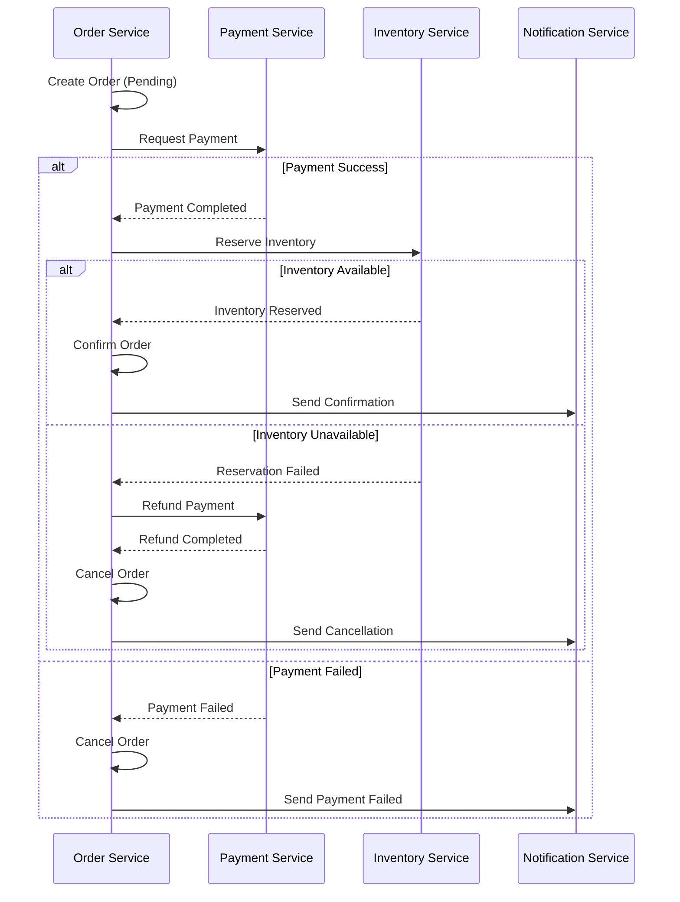

```typescript
// Saga Orchestrator Implementation
import { EventEmitter } from 'events';

interface SagaStep<T> {
  name: string;
  execute: (context: T) => Promise<void>;
  compensate: (context: T) => Promise<void>;
}

class SagaOrchestrator<T> {
  private steps: SagaStep<T>[] = [];
  private executedSteps: SagaStep<T>[] = [];
  private eventEmitter = new EventEmitter();

  addStep(step: SagaStep<T>): this {
    this.steps.push(step);
    return this;
  }

  async execute(context: T): Promise<void> {
    this.eventEmitter.emit('saga:started', { context });

    for (const step of this.steps) {
      try {
        this.eventEmitter.emit('step:started', { step: step.name });
        await step.execute(context);
        this.executedSteps.push(step);
        this.eventEmitter.emit('step:completed', { step: step.name });
      } catch (error) {
        this.eventEmitter.emit('step:failed', { step: step.name, error });
        await this.compensate(context, error);
        throw error;
      }
    }

    this.eventEmitter.emit('saga:completed', { context });
  }

  private async compensate(context: T, originalError: Error): Promise<void> {
    this.eventEmitter.emit('compensation:started', { originalError });

    // Execute compensations in reverse order
    for (const step of this.executedSteps.reverse()) {
      try {
        this.eventEmitter.emit('compensation:step', { step: step.name });
        await step.compensate(context);
      } catch (compensationError) {
        // Log but continue with other compensations
        this.eventEmitter.emit('compensation:error', {
          step: step.name,
          error: compensationError
        });
      }
    }

    this.eventEmitter.emit('compensation:completed');
  }

  on(event: string, handler: (...args: any[]) => void): this {
    this.eventEmitter.on(event, handler);
    return this;
  }
}

// Order Processing Saga
interface OrderSagaContext {
  orderId: string;
  customerId: string;
  items: Array<{ productId: string; quantity: number; price: number }>;
  totalAmount: number;
  paymentId?: string;
  reservationId?: string;
}

const createOrderSaga = (
  orderService: OrderService,
  paymentService: PaymentService,
  inventoryService: InventoryService,
  notificationService: NotificationService
) => {
  return new SagaOrchestrator<OrderSagaContext>()
    .addStep({
      name: 'CreatePendingOrder',
      execute: async (ctx) => {
        await orderService.createOrder({
          id: ctx.orderId,
          customerId: ctx.customerId,
          items: ctx.items,
          status: 'pending'
        });
      },
      compensate: async (ctx) => {
        await orderService.updateStatus(ctx.orderId, 'cancelled');
      }
    })
    .addStep({
      name: 'ProcessPayment',
      execute: async (ctx) => {
        const result = await paymentService.charge({
          customerId: ctx.customerId,
          amount: ctx.totalAmount,
          orderId: ctx.orderId,
          idempotencyKey: `order-${ctx.orderId}`
        });
        ctx.paymentId = result.paymentId;
      },
      compensate: async (ctx) => {
        if (ctx.paymentId) {
          await paymentService.refund(ctx.paymentId);
        }
      }
    })
    .addStep({
      name: 'ReserveInventory',
      execute: async (ctx) => {
        const result = await inventoryService.reserve({
          orderId: ctx.orderId,
          items: ctx.items.map(i => ({
            productId: i.productId,
            quantity: i.quantity
          }))
        });
        ctx.reservationId = result.reservationId;
      },
      compensate: async (ctx) => {
        if (ctx.reservationId) {
          await inventoryService.releaseReservation(ctx.reservationId);
        }
      }
    })
    .addStep({
      name: 'ConfirmOrder',
      execute: async (ctx) => {
        await orderService.updateStatus(ctx.orderId, 'confirmed');
      },
      compensate: async (ctx) => {
        // Already handled by CreatePendingOrder compensation
      }
    })
    .addStep({
      name: 'SendNotification',
      execute: async (ctx) => {
        await notificationService.sendOrderConfirmation({
          customerId: ctx.customerId,
          orderId: ctx.orderId
        });
      },
      compensate: async (ctx) => {
        await notificationService.sendOrderCancellation({
          customerId: ctx.customerId,
          orderId: ctx.orderId,
          reason: 'Order processing failed'
        });
      }
    })
    .on('saga:started', ({ context }) => {
      console.log(`Starting order saga for order ${context.orderId}`);
    })
    .on('step:failed', ({ step, error }) => {
      console.error(`Step ${step} failed:`, error);
    })
    .on('compensation:completed', () => {
      console.log('Saga compensation completed');
    });
};

// Usage
const saga = createOrderSaga(orderService, paymentService, inventoryService, notificationService);

try {
  await saga.execute({
    orderId: 'order-123',
    customerId: 'customer-456',
    items: [
      { productId: 'prod-1', quantity: 2, price: 29.99 },
      { productId: 'prod-2', quantity: 1, price: 49.99 }
    ],
    totalAmount: 109.97
  });
} catch (error) {
  console.error('Order saga failed:', error);
}
```

---

## Single-Tenant to Multi-Tenant

### Multi-Tenancy Models

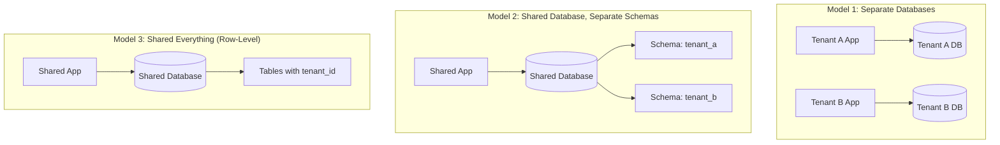

### Row-Level Security Implementation

```sql
-- PostgreSQL Row-Level Security for Multi-Tenancy

-- Enable RLS on tables
ALTER TABLE orders ENABLE ROW LEVEL SECURITY;
ALTER TABLE customers ENABLE ROW LEVEL SECURITY;
ALTER TABLE products ENABLE ROW LEVEL SECURITY;

-- Create tenant context function
CREATE OR REPLACE FUNCTION current_tenant_id()
RETURNS UUID AS $$
BEGIN
  RETURN current_setting('app.current_tenant_id', true)::UUID;
EXCEPTION
  WHEN OTHERS THEN
    RETURN NULL;
END;
$$ LANGUAGE plpgsql SECURITY DEFINER;

-- Create policies for orders table
CREATE POLICY tenant_isolation_orders ON orders
  FOR ALL
  USING (tenant_id = current_tenant_id())
  WITH CHECK (tenant_id = current_tenant_id());

-- Create policies for customers table
CREATE POLICY tenant_isolation_customers ON customers
  FOR ALL
  USING (tenant_id = current_tenant_id())
  WITH CHECK (tenant_id = current_tenant_id());

-- Super admin bypass policy
CREATE POLICY admin_bypass_orders ON orders
  FOR ALL
  TO admin_role
  USING (true)
  WITH CHECK (true);

-- Tenant-aware indexes for performance
CREATE INDEX idx_orders_tenant_status ON orders(tenant_id, status);
CREATE INDEX idx_orders_tenant_created ON orders(tenant_id, created_at DESC);
CREATE INDEX idx_customers_tenant_email ON customers(tenant_id, email);
```

```python
# Python middleware for tenant context
from contextvars import ContextVar
from functools import wraps
import asyncpg

tenant_context: ContextVar[str] = ContextVar('tenant_id', default=None)

class TenantMiddleware:
    def __init__(self, app):
        self.app = app

    async def __call__(self, scope, receive, send):
        if scope['type'] == 'http':
            headers = dict(scope['headers'])
            tenant_id = headers.get(b'x-tenant-id', b'').decode()

            if not tenant_id:
                # Extract from JWT or subdomain
                tenant_id = await self._extract_tenant_from_auth(scope)

            if tenant_id:
                token = tenant_context.set(tenant_id)
                try:
                    await self.app(scope, receive, send)
                finally:
                    tenant_context.reset(token)
            else:
                await self._send_unauthorized(send)
        else:
            await self.app(scope, receive, send)

    async def _extract_tenant_from_auth(self, scope):
        # Extract tenant from JWT token or subdomain
        host = dict(scope['headers']).get(b'host', b'').decode()
        if '.' in host:
            subdomain = host.split('.')[0]
            tenant = await self._lookup_tenant_by_subdomain(subdomain)
            return tenant.id if tenant else None
        return None

class TenantAwareConnection:
    """Database connection with automatic tenant context."""

    def __init__(self, pool: asyncpg.Pool):
        self.pool = pool

    async def execute(self, query: str, *args):
        tenant_id = tenant_context.get()
        if not tenant_id:
            raise TenantContextMissing("No tenant context set")

        async with self.pool.acquire() as conn:
            # Set tenant context for RLS
            await conn.execute(
                "SELECT set_config('app.current_tenant_id', $1, true)",
                tenant_id
            )
            return await conn.execute(query, *args)

    async def fetch(self, query: str, *args):
        tenant_id = tenant_context.get()
        if not tenant_id:
            raise TenantContextMissing("No tenant context set")

        async with self.pool.acquire() as conn:
            await conn.execute(
                "SELECT set_config('app.current_tenant_id', $1, true)",
                tenant_id
            )
            return await conn.fetch(query, *args)

# Repository with tenant isolation
class OrderRepository:
    def __init__(self, db: TenantAwareConnection):
        self.db = db

    async def find_by_id(self, order_id: str) -> Order:
        # RLS automatically filters by tenant
        row = await self.db.fetchrow(
            "SELECT * FROM orders WHERE id = $1",
            order_id
        )
        return Order.from_row(row) if row else None

    async def create(self, order: Order) -> Order:
        tenant_id = tenant_context.get()
        row = await self.db.fetchrow(
            """
            INSERT INTO orders (id, tenant_id, customer_id, status, total_amount)
            VALUES ($1, $2, $3, $4, $5)
            RETURNING *
            """,
            order.id, tenant_id, order.customer_id, order.status, order.total_amount
        )
        return Order.from_row(row)
```

### Tenant Data Migration

```python
# Migrating single-tenant to multi-tenant schema
import asyncio
from typing import List

class TenantMigration:
    def __init__(self, source_db, target_db):
        self.source = source_db
        self.target = target_db

    async def migrate_tenant(self, tenant_id: str, batch_size: int = 1000):
        """Migrate all data for a tenant with minimal downtime."""

        tables = ['customers', 'orders', 'order_items', 'products']

        for table in tables:
            await self._migrate_table(tenant_id, table, batch_size)

    async def _migrate_table(self, tenant_id: str, table: str, batch_size: int):
        offset = 0

        while True:
            # Read batch from source
            rows = await self.source.fetch(
                f"SELECT * FROM {table} ORDER BY id OFFSET $1 LIMIT $2",
                offset, batch_size
            )

            if not rows:
                break

            # Transform: add tenant_id column
            transformed = [
                {**dict(row), 'tenant_id': tenant_id}
                for row in rows
            ]

            # Write to target with upsert
            columns = list(transformed[0].keys())
            placeholders = ', '.join(f'${i+1}' for i in range(len(columns)))

            await self.target.executemany(
                f"""
                INSERT INTO {table} ({', '.join(columns)})
                VALUES ({placeholders})
                ON CONFLICT (id) DO UPDATE SET
                {', '.join(f'{col} = EXCLUDED.{col}' for col in columns if col != 'id')}
                """,
                [tuple(row.values()) for row in transformed]
            )

            offset += batch_size
            print(f"Migrated {offset} rows from {table}")

    async def verify_migration(self, tenant_id: str) -> dict:
        """Verify data integrity after migration."""
        results = {}
        tables = ['customers', 'orders', 'order_items', 'products']

        for table in tables:
            source_count = await self.source.fetchval(
                f"SELECT COUNT(*) FROM {table}"
            )
            target_count = await self.target.fetchval(
                f"SELECT COUNT(*) FROM {table} WHERE tenant_id = $1",
                tenant_id
            )

            results[table] = {
                'source': source_count,
                'target': target_count,
                'match': source_count == target_count
            }

        return results
```

---

## API Versioning Strategies

### Strategy Comparison

| Strategy | URL Example | Pros | Cons |
|----------|-------------|------|------|
| URL Path | `/v1/orders` | Clear, cacheable | URL pollution |
| Query Param | `/orders?version=1` | Flexible | Less visible |
| Header | `Accept: application/vnd.api.v1+json` | Clean URLs | Hidden version |
| Content Negotiation | `Accept: application/vnd.company.order.v1+json` | RESTful | Complex |

### Implementation: URL Path Versioning

```typescript
// Express.js API Versioning
import express, { Router, Request, Response, NextFunction } from 'express';

// Version-specific routers
const v1Router = Router();
const v2Router = Router();

// V1 API - Original format
v1Router.get('/orders/:id', async (req: Request, res: Response) => {
  const order = await orderService.getOrder(req.params.id);
  res.json({
    id: order.id,
    customer_id: order.customerId,  // snake_case
    items: order.items,
    total: order.totalAmount,
    status: order.status
  });
});

// V2 API - New format with breaking changes
v2Router.get('/orders/:id', async (req: Request, res: Response) => {
  const order = await orderService.getOrder(req.params.id);
  res.json({
    id: order.id,
    customerId: order.customerId,  // camelCase
    lineItems: order.items.map(item => ({
      productId: item.productId,
      quantity: item.quantity,
      unitPrice: {
        amount: item.price,
        currency: 'USD'
      }
    })),
    totals: {
      subtotal: order.subtotal,
      tax: order.tax,
      total: order.totalAmount
    },
    status: order.status,
    _links: {  // HATEOAS
      self: { href: `/v2/orders/${order.id}` },
      customer: { href: `/v2/customers/${order.customerId}` },
      cancel: order.status === 'pending'
        ? { href: `/v2/orders/${order.id}/cancel`, method: 'POST' }
        : null
    }
  });
});

// Versioned app setup
const app = express();

// API versioning middleware
app.use('/v1', v1Router);
app.use('/v2', v2Router);

// Deprecation warning middleware
app.use('/v1', (req: Request, res: Response, next: NextFunction) => {
  res.set('Deprecation', 'true');
  res.set('Sunset', 'Sat, 01 Jan 2025 00:00:00 GMT');
  res.set('Link', '</v2' + req.path + '>; rel="successor-version"');
  next();
});
```

### Header-Based Versioning with Content Negotiation

```typescript
// Custom media type versioning
import { Request, Response, NextFunction } from 'express';

interface VersionedRequest extends Request {
  apiVersion: number;
}

const versionMiddleware = (req: VersionedRequest, res: Response, next: NextFunction) => {
  const acceptHeader = req.get('Accept') || '';

  // Parse: application/vnd.company.resource.v2+json
  const versionMatch = acceptHeader.match(/application\/vnd\.company\.\w+\.v(\d+)\+json/);

  if (versionMatch) {
    req.apiVersion = parseInt(versionMatch[1], 10);
  } else {
    // Default to latest stable version
    req.apiVersion = 2;
  }

  // Set response content type
  res.type(`application/vnd.company.order.v${req.apiVersion}+json`);

  next();
};

// Version-aware controller
class OrderController {
  private transformers = new Map<number, OrderTransformer>();

  constructor() {
    this.transformers.set(1, new OrderTransformerV1());
    this.transformers.set(2, new OrderTransformerV2());
  }

  async getOrder(req: VersionedRequest, res: Response) {
    const order = await this.orderService.getOrder(req.params.id);
    const transformer = this.transformers.get(req.apiVersion);

    if (!transformer) {
      return res.status(406).json({
        error: 'Unsupported API version',
        supportedVersions: Array.from(this.transformers.keys())
      });
    }

    res.json(transformer.transform(order));
  }
}

// Version-specific transformers
interface OrderTransformer {
  transform(order: Order): object;
}

class OrderTransformerV1 implements OrderTransformer {
  transform(order: Order) {
    return {
      id: order.id,
      customer_id: order.customerId,
      items: order.items,
      total: order.totalAmount,
      status: order.status
    };
  }
}

class OrderTransformerV2 implements OrderTransformer {
  transform(order: Order) {
    return {
      id: order.id,
      customerId: order.customerId,
      lineItems: order.items.map(item => ({
        productId: item.productId,
        quantity: item.quantity,
        unitPrice: { amount: item.price, currency: 'USD' }
      })),
      totals: {
        subtotal: order.subtotal,
        tax: order.tax,
        total: order.totalAmount
      },
      status: order.status,
      _links: this.buildLinks(order)
    };
  }

  private buildLinks(order: Order) {
    return {
      self: { href: `/orders/${order.id}` },
      customer: { href: `/customers/${order.customerId}` }
    };
  }
}
```

---

## Cross-Cutting Concerns

### Service Discovery and API Gateway

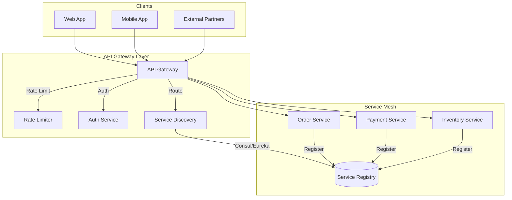

```yaml
# Kong API Gateway Configuration
_format_version: "3.0"

services:
  - name: order-service
    url: http://order-service:8080
    routes:
      - name: orders-route
        paths:
          - /api/v1/orders
          - /api/v2/orders
        methods:
          - GET
          - POST
          - PUT
          - DELETE
    plugins:
      - name: rate-limiting
        config:
          minute: 100
          policy: local
      - name: jwt
        config:
          secret_is_base64: false
          claims_to_verify:
            - exp
      - name: correlation-id
        config:
          header_name: X-Correlation-ID
          generator: uuid
      - name: request-transformer
        config:
          add:
            headers:
              - "X-Service-Version:v1"

  - name: payment-service
    url: http://payment-service:8080
    routes:
      - name: payments-route
        paths:
          - /api/v1/payments
        methods:
          - POST
    plugins:
      - name: rate-limiting
        config:
          minute: 50
          policy: local
      - name: jwt
      - name: request-size-limiting
        config:
          allowed_payload_size: 1  # MB

upstreams:
  - name: order-service-upstream
    targets:
      - target: order-service-1:8080
        weight: 100
      - target: order-service-2:8080
        weight: 100
    healthchecks:
      active:
        http_path: /health
        healthy:
          interval: 5
          successes: 2
        unhealthy:
          interval: 5
          http_failures: 3
```

### Distributed Authentication (OAuth 2.0 + JWT)

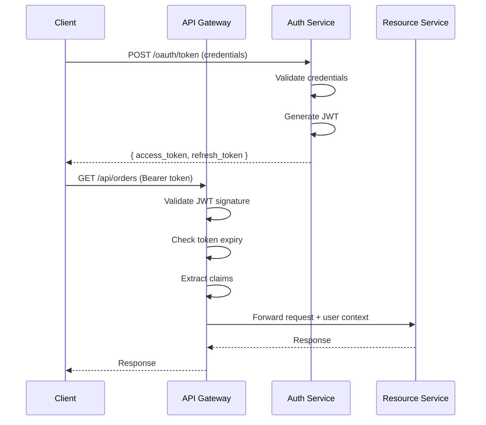

```typescript
// JWT Validation Middleware for Microservices
import jwt from 'jsonwebtoken';
import jwksClient from 'jwks-rsa';

interface JWTPayload {
  sub: string;
  email: string;
  roles: string[];
  tenant_id: string;
  permissions: string[];
  exp: number;
  iat: number;
  iss: string;
  aud: string[];
}

class JWTAuthMiddleware {
  private jwksClient: jwksClient.JwksClient;

  constructor(jwksUri: string) {
    this.jwksClient = jwksClient({
      jwksUri,
      cache: true,
      cacheMaxAge: 86400000, // 24 hours
      rateLimit: true
    });
  }

  middleware() {
    return async (req: Request, res: Response, next: NextFunction) => {
      const authHeader = req.headers.authorization;

      if (!authHeader?.startsWith('Bearer ')) {
        return res.status(401).json({ error: 'Missing authorization header' });
      }

      const token = authHeader.slice(7);

      try {
        const decoded = await this.verifyToken(token);

        // Attach user context to request
        req.user = {
          id: decoded.sub,
          email: decoded.email,
          roles: decoded.roles,
          tenantId: decoded.tenant_id,
          permissions: decoded.permissions
        };

        // Set tenant context for downstream services
        req.headers['x-tenant-id'] = decoded.tenant_id;
        req.headers['x-user-id'] = decoded.sub;

        next();
      } catch (error) {
        if (error.name === 'TokenExpiredError') {
          return res.status(401).json({ error: 'Token expired' });
        }
        return res.status(401).json({ error: 'Invalid token' });
      }
    };
  }

  private async verifyToken(token: string): Promise<JWTPayload> {
    const decodedHeader = jwt.decode(token, { complete: true });
    const kid = decodedHeader?.header.kid;

    if (!kid) {
      throw new Error('No key ID in token header');
    }

    const key = await this.jwksClient.getSigningKey(kid);
    const publicKey = key.getPublicKey();

    return jwt.verify(token, publicKey, {
      algorithms: ['RS256'],
      issuer: process.env.JWT_ISSUER,
      audience: process.env.JWT_AUDIENCE
    }) as JWTPayload;
  }
}

// Permission-based authorization
const requirePermission = (...permissions: string[]) => {
  return (req: Request, res: Response, next: NextFunction) => {
    const userPermissions = req.user?.permissions || [];

    const hasPermission = permissions.every(
      p => userPermissions.includes(p)
    );

    if (!hasPermission) {
      return res.status(403).json({
        error: 'Insufficient permissions',
        required: permissions,
        actual: userPermissions
      });
    }

    next();
  };
};

// Usage
app.get('/orders',
  jwtAuth.middleware(),
  requirePermission('orders:read'),
  orderController.list
);

app.post('/orders',
  jwtAuth.middleware(),
  requirePermission('orders:create'),
  orderController.create
);
```

### Distributed Tracing

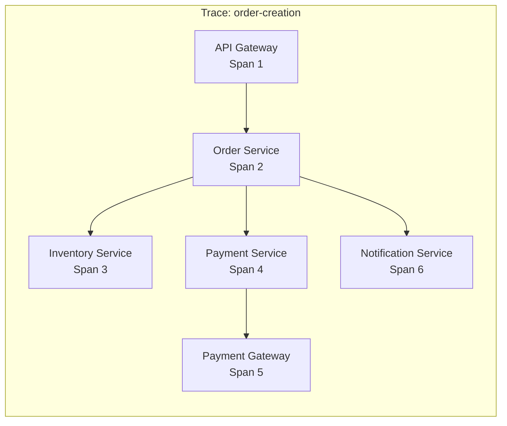

```typescript
// OpenTelemetry Tracing Setup
import { NodeSDK } from '@opentelemetry/sdk-node';
import { getNodeAutoInstrumentations } from '@opentelemetry/auto-instrumentations-node';
import { OTLPTraceExporter } from '@opentelemetry/exporter-trace-otlp-http';
import { Resource } from '@opentelemetry/resources';
import { SemanticResourceAttributes } from '@opentelemetry/semantic-conventions';
import { trace, context, SpanKind, SpanStatusCode } from '@opentelemetry/api';

// Initialize tracing
const sdk = new NodeSDK({
  resource: new Resource({
    [SemanticResourceAttributes.SERVICE_NAME]: 'order-service',
    [SemanticResourceAttributes.SERVICE_VERSION]: '1.0.0',
    [SemanticResourceAttributes.DEPLOYMENT_ENVIRONMENT]: process.env.NODE_ENV
  }),
  traceExporter: new OTLPTraceExporter({
    url: process.env.OTEL_EXPORTER_OTLP_ENDPOINT || 'http://jaeger:4318/v1/traces'
  }),
  instrumentations: [
    getNodeAutoInstrumentations({
      '@opentelemetry/instrumentation-fs': { enabled: false }
    })
  ]
});

sdk.start();

// Custom span creation
const tracer = trace.getTracer('order-service');

class OrderService {
  async createOrder(request: CreateOrderRequest): Promise<Order> {
    return tracer.startActiveSpan('createOrder', {
      kind: SpanKind.INTERNAL,
      attributes: {
        'order.customer_id': request.customerId,
        'order.item_count': request.items.length
      }
    }, async (span) => {
      try {
        // Validate inventory
        const inventoryResult = await tracer.startActiveSpan('validateInventory',
          { kind: SpanKind.CLIENT },
          async (inventorySpan) => {
            try {
              const result = await this.inventoryClient.checkAvailability(request.items);
              inventorySpan.setAttribute('inventory.available', result.available);
              return result;
            } finally {
              inventorySpan.end();
            }
          }
        );

        if (!inventoryResult.available) {
          span.setStatus({ code: SpanStatusCode.ERROR, message: 'Inventory unavailable' });
          throw new InsufficientInventoryError();
        }

        // Process payment
        const paymentResult = await tracer.startActiveSpan('processPayment',
          { kind: SpanKind.CLIENT },
          async (paymentSpan) => {
            try {
              paymentSpan.setAttribute('payment.amount', request.totalAmount);
              const result = await this.paymentClient.charge(request);
              paymentSpan.setAttribute('payment.id', result.paymentId);
              return result;
            } finally {
              paymentSpan.end();
            }
          }
        );

        // Create order
        const order = await this.orderRepository.create({
          customerId: request.customerId,
          items: request.items,
          paymentId: paymentResult.paymentId,
          status: 'confirmed'
        });

        span.setAttribute('order.id', order.id);
        span.setStatus({ code: SpanStatusCode.OK });

        return order;
      } catch (error) {
        span.recordException(error);
        span.setStatus({ code: SpanStatusCode.ERROR, message: error.message });
        throw error;
      } finally {
        span.end();
      }
    });
  }
}

// Context propagation in HTTP client
import axios from 'axios';
import { W3CTraceContextPropagator } from '@opentelemetry/core';

const propagator = new W3CTraceContextPropagator();

class TracedHttpClient {
  async request<T>(config: AxiosRequestConfig): Promise<T> {
    const headers: Record<string, string> = {};

    // Inject trace context into headers
    propagator.inject(context.active(), headers, {
      set: (carrier, key, value) => { carrier[key] = value; }
    });

    const response = await axios({
      ...config,
      headers: { ...config.headers, ...headers }
    });

    return response.data;
  }
}
```

---

## Testing Strategies

### Contract Testing with Pact

```typescript
// Consumer Contract Test (Order Service consuming Inventory API)
import { PactV3, MatchersV3 } from '@pact-foundation/pact';

const { like, eachLike, integer, string, boolean } = MatchersV3;

describe('Inventory Service Contract', () => {
  const provider = new PactV3({
    consumer: 'OrderService',
    provider: 'InventoryService',
    logLevel: 'warn'
  });

  describe('check stock availability', () => {
    it('returns availability for products', async () => {
      // Arrange: Define expected interaction
      await provider
        .given('products exist in inventory')
        .uponReceiving('a request to check stock availability')
        .withRequest({
          method: 'POST',
          path: '/api/v1/inventory/check',
          headers: {
            'Content-Type': 'application/json',
            'X-Correlation-ID': like('550e8400-e29b-41d4-a716-446655440000')
          },
          body: {
            items: eachLike({
              productId: string('prod-123'),
              quantity: integer(2)
            })
          }
        })
        .willRespondWith({
          status: 200,
          headers: {
            'Content-Type': 'application/json'
          },
          body: {
            available: boolean(true),
            items: eachLike({
              productId: string('prod-123'),
              requestedQuantity: integer(2),
              availableQuantity: integer(100),
              isAvailable: boolean(true)
            })
          }
        });

      // Act: Execute the consumer code
      await provider.executeTest(async (mockServer) => {
        const client = new InventoryClient(mockServer.url);
        const result = await client.checkAvailability([
          { productId: 'prod-123', quantity: 2 }
        ]);

        // Assert: Verify consumer behavior
        expect(result.available).toBe(true);
        expect(result.items[0].isAvailable).toBe(true);
      });
    });

    it('handles insufficient stock', async () => {
      await provider
        .given('product has insufficient stock')
        .uponReceiving('a request for more than available')
        .withRequest({
          method: 'POST',
          path: '/api/v1/inventory/check',
          headers: { 'Content-Type': 'application/json' },
          body: {
            items: [{ productId: 'prod-456', quantity: 1000 }]
          }
        })
        .willRespondWith({
          status: 200,
          body: {
            available: false,
            items: [{
              productId: 'prod-456',
              requestedQuantity: 1000,
              availableQuantity: 50,
              isAvailable: false
            }]
          }
        });

      await provider.executeTest(async (mockServer) => {
        const client = new InventoryClient(mockServer.url);
        const result = await client.checkAvailability([
          { productId: 'prod-456', quantity: 1000 }
        ]);

        expect(result.available).toBe(false);
      });
    });
  });
});

// Provider Verification Test (Inventory Service)
import { Verifier } from '@pact-foundation/pact';

describe('Inventory Service Provider Verification', () => {
  it('validates the expectations of Order Service', async () => {
    const verifier = new Verifier({
      providerBaseUrl: 'http://localhost:8080',
      pactBrokerUrl: process.env.PACT_BROKER_URL,
      provider: 'InventoryService',
      providerVersion: process.env.GIT_COMMIT,
      publishVerificationResult: process.env.CI === 'true',
      stateHandlers: {
        'products exist in inventory': async () => {
          // Setup test data
          await testDb.insert('products', [
            { id: 'prod-123', name: 'Widget', stock: 100 }
          ]);
        },
        'product has insufficient stock': async () => {
          await testDb.insert('products', [
            { id: 'prod-456', name: 'Gadget', stock: 50 }
          ]);
        }
      }
    });

    await verifier.verifyProvider();
  });
});
```

### Chaos Engineering

```yaml
# Chaos Mesh Experiment - Network Partition
apiVersion: chaos-mesh.org/v1alpha1
kind: NetworkChaos
metadata:
  name: order-payment-partition
  namespace: production
spec:
  action: partition
  mode: all
  selector:
    namespaces:
      - production
    labelSelectors:
      app: order-service
  direction: both
  target:
    selector:
      namespaces:
        - production
      labelSelectors:
        app: payment-service
    mode: all
  duration: "30s"
  scheduler:
    cron: "@every 1h"
---
# Chaos Mesh Experiment - Pod Failure
apiVersion: chaos-mesh.org/v1alpha1
kind: PodChaos
metadata:
  name: random-pod-failure
  namespace: production
spec:
  action: pod-failure
  mode: one
  selector:
    namespaces:
      - production
    labelSelectors:
      tier: backend
  duration: "60s"
  scheduler:
    cron: "0 */4 * * *"
---
# Chaos Mesh Experiment - Latency Injection
apiVersion: chaos-mesh.org/v1alpha1
kind: NetworkChaos
metadata:
  name: database-latency
  namespace: production
spec:
  action: delay
  mode: all
  selector:
    namespaces:
      - production
    labelSelectors:
      app: order-service
  delay:
    latency: "200ms"
    correlation: "50"
    jitter: "50ms"
  target:
    selector:
      namespaces:
        - production
      labelSelectors:
        app: postgres
    mode: all
  duration: "5m"
```

```python
# Automated Chaos Testing Framework
import asyncio
from dataclasses import dataclass
from typing import Callable, List
import aiohttp

@dataclass
class ChaosExperiment:
    name: str
    hypothesis: str
    inject_fault: Callable
    verify_steady_state: Callable
    rollback: Callable
    duration_seconds: int = 60

class ChaosRunner:
    def __init__(self, experiments: List[ChaosExperiment]):
        self.experiments = experiments
        self.results = []

    async def run_experiment(self, experiment: ChaosExperiment) -> dict:
        result = {
            'name': experiment.name,
            'hypothesis': experiment.hypothesis,
            'passed': False,
            'steady_state_before': None,
            'steady_state_during': None,
            'steady_state_after': None,
            'error': None
        }

        try:
            # 1. Verify steady state before
            print(f"Verifying steady state before: {experiment.name}")
            result['steady_state_before'] = await experiment.verify_steady_state()

            if not result['steady_state_before']['healthy']:
                result['error'] = 'System not healthy before experiment'
                return result

            # 2. Inject fault
            print(f"Injecting fault: {experiment.name}")
            await experiment.inject_fault()

            # 3. Wait and verify during fault
            await asyncio.sleep(experiment.duration_seconds / 2)
            result['steady_state_during'] = await experiment.verify_steady_state()

            # 4. Wait for remaining duration
            await asyncio.sleep(experiment.duration_seconds / 2)

            # 5. Rollback
            print(f"Rolling back: {experiment.name}")
            await experiment.rollback()

            # 6. Verify steady state after
            await asyncio.sleep(10)  # Grace period
            result['steady_state_after'] = await experiment.verify_steady_state()

            # 7. Evaluate hypothesis
            result['passed'] = (
                result['steady_state_during']['healthy'] and
                result['steady_state_after']['healthy']
            )

        except Exception as e:
            result['error'] = str(e)
            await experiment.rollback()

        return result

# Example: Test circuit breaker behavior
async def verify_order_service_steady_state() -> dict:
    async with aiohttp.ClientSession() as session:
        try:
            # Check health endpoint
            async with session.get('http://order-service:8080/health') as resp:
                health = await resp.json()

            # Check error rate from metrics
            async with session.get('http://prometheus:9090/api/v1/query',
                params={'query': 'rate(http_requests_total{status=~"5.."}[1m])'}) as resp:
                metrics = await resp.json()
                error_rate = float(metrics['data']['result'][0]['value'][1]) if metrics['data']['result'] else 0

            return {
                'healthy': health['status'] == 'healthy' and error_rate < 0.01,
                'error_rate': error_rate,
                'health_check': health
            }
        except Exception as e:
            return {'healthy': False, 'error': str(e)}

async def inject_payment_service_failure():
    # Use Chaos Mesh API to inject failure
    async with aiohttp.ClientSession() as session:
        await session.post('http://chaos-mesh:2333/api/experiments', json={
            'kind': 'PodChaos',
            'spec': {
                'action': 'pod-failure',
                'selector': {'labelSelectors': {'app': 'payment-service'}},
                'duration': '60s'
            }
        })

async def rollback_payment_service_failure():
    async with aiohttp.ClientSession() as session:
        await session.delete('http://chaos-mesh:2333/api/experiments/payment-failure')

# Define experiment
circuit_breaker_experiment = ChaosExperiment(
    name='payment-service-failure',
    hypothesis='When payment service fails, order service should degrade gracefully using circuit breaker',
    inject_fault=inject_payment_service_failure,
    verify_steady_state=verify_order_service_steady_state,
    rollback=rollback_payment_service_failure,
    duration_seconds=60
)
```

---

## Deployment and Rollback

### Blue-Green Deployment

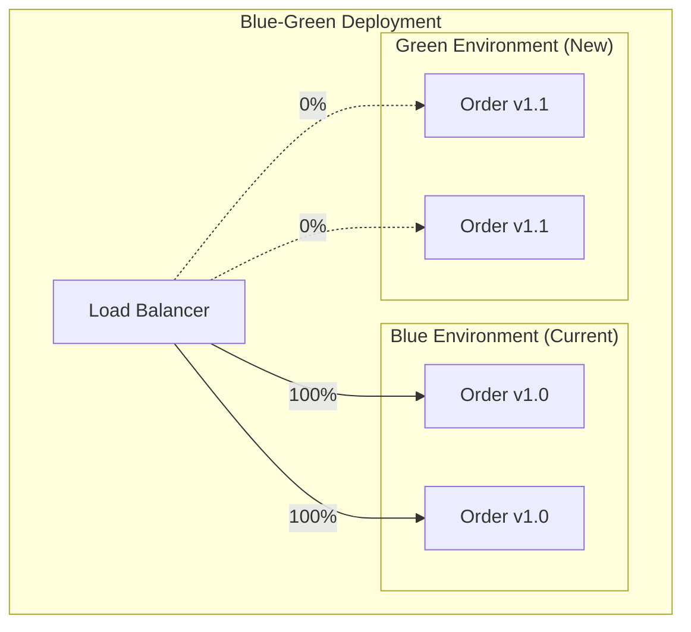

```yaml
# Kubernetes Blue-Green with Argo Rollouts
apiVersion: argoproj.io/v1alpha1
kind: Rollout
metadata:
  name: order-service
spec:
  replicas: 4
  strategy:
    blueGreen:
      activeService: order-service-active
      previewService: order-service-preview
      autoPromotionEnabled: false
      scaleDownDelaySeconds: 30
      prePromotionAnalysis:
        templates:
          - templateName: success-rate
        args:
          - name: service-name
            value: order-service-preview
      postPromotionAnalysis:
        templates:
          - templateName: success-rate
        args:
          - name: service-name
            value: order-service-active
  selector:
    matchLabels:
      app: order-service
  template:
    metadata:
      labels:
        app: order-service
    spec:
      containers:
        - name: order-service
          image: order-service:1.1.0
          ports:
            - containerPort: 8080
          readinessProbe:
            httpGet:
              path: /health/ready
              port: 8080
            initialDelaySeconds: 10
            periodSeconds: 5
          livenessProbe:
            httpGet:
              path: /health/live
              port: 8080
            initialDelaySeconds: 15
            periodSeconds: 10
---
apiVersion: argoproj.io/v1alpha1
kind: AnalysisTemplate
metadata:
  name: success-rate
spec:
  args:
    - name: service-name
  metrics:
    - name: success-rate
      interval: 30s
      count: 10
      successCondition: result[0] >= 0.99
      failureLimit: 3
      provider:
        prometheus:
          address: http://prometheus:9090
          query: |
            sum(rate(http_requests_total{
              service="{{args.service-name}}",
              status=~"2.."
            }[1m])) /
            sum(rate(http_requests_total{
              service="{{args.service-name}}"
            }[1m]))
    - name: latency-p99
      interval: 30s
      count: 10
      successCondition: result[0] <= 500
      failureLimit: 3
      provider:
        prometheus:
          address: http://prometheus:9090
          query: |
            histogram_quantile(0.99, sum(rate(http_request_duration_seconds_bucket{
              service="{{args.service-name}}"
            }[1m])) by (le)) * 1000
```

### Canary Deployment with Progressive Rollout

```yaml
# Istio Canary with Traffic Splitting
apiVersion: networking.istio.io/v1beta1
kind: VirtualService
metadata:
  name: order-service
spec:
  hosts:
    - order-service
  http:
    - match:
        - headers:
            x-canary:
              exact: "true"
      route:
        - destination:
            host: order-service
            subset: canary
    - route:
        - destination:
            host: order-service
            subset: stable
          weight: 90
        - destination:
            host: order-service
            subset: canary
          weight: 10
---
apiVersion: networking.istio.io/v1beta1
kind: DestinationRule
metadata:
  name: order-service
spec:
  host: order-service
  subsets:
    - name: stable
      labels:
        version: v1.0.0
    - name: canary
      labels:
        version: v1.1.0
  trafficPolicy:
    connectionPool:
      tcp:
        maxConnections: 100
      http:
        h2UpgradePolicy: UPGRADE
        http1MaxPendingRequests: 100
        http2MaxRequests: 1000
    outlierDetection:
      consecutive5xxErrors: 5
      interval: 30s
      baseEjectionTime: 30s
      maxEjectionPercent: 50
```

### Distributed Rollback Strategy

```typescript
// Coordinated Rollback Controller
interface ServiceVersion {
  name: string;
  currentVersion: string;
  previousVersion: string;
  deploymentTime: Date;
}

interface RollbackPlan {
  services: ServiceVersion[];
  rollbackOrder: string[];
  dataRollbackRequired: boolean;
  estimatedDuration: number;
}

class DistributedRollbackController {
  constructor(
    private kubeClient: KubernetesClient,
    private featureFlags: FeatureFlagService,
    private eventBus: EventBus,
    private metrics: MetricsClient
  ) {}

  async initiateRollback(trigger: RollbackTrigger): Promise<RollbackResult> {
    const plan = await this.createRollbackPlan(trigger);

    console.log(`Initiating rollback: ${JSON.stringify(plan)}`);
    this.metrics.increment('rollback.initiated', { trigger: trigger.reason });

    try {
      // 1. Disable feature flags for new features
      await this.disableNewFeatures(plan);

      // 2. Stop accepting new traffic for affected services
      await this.drainConnections(plan.services);

      // 3. Rollback services in dependency order
      for (const serviceName of plan.rollbackOrder) {
        await this.rollbackService(serviceName, plan);
      }

      // 4. Handle data rollback if needed
      if (plan.dataRollbackRequired) {
        await this.rollbackData(plan);
      }

      // 5. Re-enable traffic
      await this.enableTraffic(plan.services);

      // 6. Verify system health
      const healthCheck = await this.verifySystemHealth();

      if (!healthCheck.healthy) {
        throw new Error(`Health check failed after rollback: ${healthCheck.details}`);
      }

      this.metrics.increment('rollback.success');

      return {
        success: true,
        duration: Date.now() - trigger.triggeredAt.getTime(),
        servicesRolledBack: plan.services.map(s => s.name)
      };
    } catch (error) {
      this.metrics.increment('rollback.failure');

      // Emit alert for manual intervention
      await this.eventBus.publish({
        eventType: 'RollbackFailed',
        payload: { plan, error: error.message }
      });

      throw error;
    }
  }

  private async createRollbackPlan(trigger: RollbackTrigger): Promise<RollbackPlan> {
    // Get affected services from deployment history
    const recentDeployments = await this.kubeClient.getRecentDeployments(
      trigger.timeWindow || '1h'
    );

    // Build dependency graph
    const dependencyGraph = await this.buildDependencyGraph(
      recentDeployments.map(d => d.serviceName)
    );

    // Determine rollback order (reverse dependency order)
    const rollbackOrder = this.topologicalSort(dependencyGraph).reverse();

    // Check if data migrations need rollback
    const dataRollbackRequired = await this.checkDataMigrations(recentDeployments);

    return {
      services: recentDeployments.map(d => ({
        name: d.serviceName,
        currentVersion: d.newVersion,
        previousVersion: d.previousVersion,
        deploymentTime: d.deployedAt
      })),
      rollbackOrder,
      dataRollbackRequired,
      estimatedDuration: this.estimateRollbackDuration(recentDeployments)
    };
  }

  private async rollbackService(
    serviceName: string,
    plan: RollbackPlan
  ): Promise<void> {
    const service = plan.services.find(s => s.name === serviceName);

    console.log(`Rolling back ${serviceName}: ${service.currentVersion} -> ${service.previousVersion}`);

    // Use Kubernetes rollback
    await this.kubeClient.rollbackDeployment(serviceName, service.previousVersion);

    // Wait for rollout to complete
    await this.kubeClient.waitForRollout(serviceName, {
      timeout: 300000, // 5 minutes
      healthCheck: true
    });

    console.log(`Successfully rolled back ${serviceName}`);
  }

  private async disableNewFeatures(plan: RollbackPlan): Promise<void> {
    // Get features deployed with the affected versions
    const recentFeatures = await this.featureFlags.getFeaturesDeployedAfter(
      Math.min(...plan.services.map(s => s.deploymentTime.getTime()))
    );

    for (const feature of recentFeatures) {
      await this.featureFlags.disable(feature.key);
      console.log(`Disabled feature flag: ${feature.key}`);
    }
  }

  private async drainConnections(services: ServiceVersion[]): Promise<void> {
    // Mark services as draining in load balancer
    for (const service of services) {
      await this.kubeClient.annotate(
        'deployment',
        service.name,
        { 'rollback.draining': 'true' }
      );
    }

    // Wait for in-flight requests to complete
    await new Promise(resolve => setTimeout(resolve, 30000));
  }
}
```

---

## Team Organization

### Conway's Law and Service Ownership

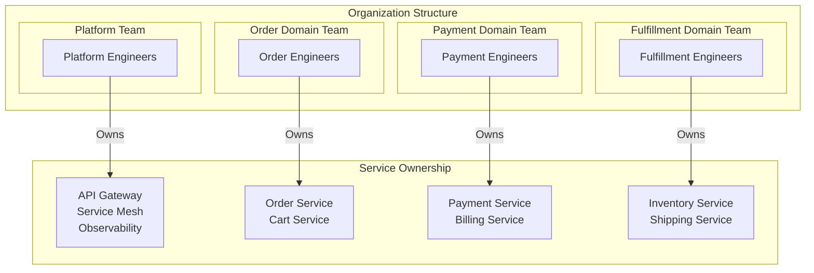

### Team Topology Patterns

```yaml
# Team API Definition (Team Topologies approach)
team:
  name: Order Domain Team
  type: stream-aligned

  owns:
    services:
      - order-service
      - cart-service
      - order-history-service
    data:
      - orders database
      - cart cache
    apis:
      - /api/v*/orders/**
      - /api/v*/carts/**

  dependencies:
    platform:
      - name: Platform Team
        interaction: x-as-a-service
        provides:
          - CI/CD pipelines
          - Kubernetes cluster
          - Observability stack

    upstream:
      - name: User Domain Team
        interaction: collaboration
        consumes:
          - User events (UserCreated, UserUpdated)
          - User API for profile data

    downstream:
      - name: Payment Domain Team
        interaction: collaboration
        provides:
          - OrderPlaced event
          - Order API for payment correlation

      - name: Fulfillment Domain Team
        interaction: x-as-a-service
        provides:
          - OrderConfirmed event
          - Shipping requirements

  slas:
    availability: 99.9%
    latency_p99: 200ms
    incident_response: 15min

  on_call:
    rotation: weekly
    escalation:
      - level: 1
        team: order-domain-oncall
        response_time: 15min
      - level: 2
        team: engineering-managers
        response_time: 30min
```

### Migration Team Structure

```markdown
## Migration Team Charter

### Core Team (Full-time)
- **Tech Lead**: Architecture decisions, code reviews, unblocking
- **2-3 Senior Engineers**: Implementation, mentoring
- **DevOps Engineer**: Infrastructure, CI/CD, monitoring
- **QA Engineer**: Test strategy, automation

### Extended Team (Part-time)
- **Product Owner**: Prioritization, stakeholder communication
- **Domain Experts**: Business logic knowledge transfer
- **SRE**: Production readiness, observability

### Communication Cadence
- Daily standup (15 min)
- Weekly architecture review (1 hour)
- Bi-weekly stakeholder demo
- Monthly retrospective

### Decision Framework
| Decision Type | Who Decides | Consultation |
|--------------|-------------|--------------|
| Architecture | Tech Lead | Team consensus |
| Timeline | Product Owner | Tech Lead input |
| Technology | Team consensus | Architecture review |
| Rollback | On-call engineer | Notify Tech Lead |
```

---

## Migration Checklist

```markdown
## Architecture Migration Checklist

### Phase 1: Assessment
- [ ] Document current architecture
- [ ] Map all service dependencies
- [ ] Identify performance baselines
- [ ] Assess team skills and gaps
- [ ] Calculate total cost of migration
- [ ] Get executive sponsorship

### Phase 2: Design
- [ ] Define bounded contexts (DDD)
- [ ] Design target architecture
- [ ] Plan database decomposition
- [ ] Design inter-service communication
- [ ] Plan authentication/authorization
- [ ] Design observability stack

### Phase 3: Foundation
- [ ] Set up CI/CD pipelines
- [ ] Deploy service mesh / API gateway
- [ ] Implement distributed tracing
- [ ] Set up centralized logging
- [ ] Configure alerting and monitoring
- [ ] Establish deployment patterns

### Phase 4: Migration
- [ ] Implement Strangler Fig pattern
- [ ] Migrate first (simplest) service
- [ ] Implement feature flags
- [ ] Set up contract tests
- [ ] Configure canary deployments
- [ ] Document runbooks

### Phase 5: Validation
- [ ] Run chaos engineering experiments
- [ ] Load test at 2x expected traffic
- [ ] Verify rollback procedures
- [ ] Complete security audit
- [ ] Performance test against baselines
- [ ] Train operations team

### Phase 6: Cutover
- [ ] Execute gradual traffic shift
- [ ] Monitor error rates continuously
- [ ] Validate data consistency
- [ ] Decommission legacy components
- [ ] Update documentation
- [ ] Conduct retrospective
```

---

## References and Further Reading

1. **Books**
   - "Building Microservices" by Sam Newman
   - "Domain-Driven Design" by Eric Evans
   - "Designing Data-Intensive Applications" by Martin Kleppmann
   - "Release It!" by Michael Nygard

2. **Case Studies**
   - Netflix: From Monolith to Microservices
   - Amazon: Service-Oriented Architecture Journey
   - Uber: Domain-Oriented Microservice Architecture
   - Spotify: Squad Model and Microservices

3. **Patterns**
   - [microservices.io](https://microservices.io/patterns/)
   - [Martin Fowler's Microservices Guide](https://martinfowler.com/microservices/)
   - [AWS Microservices Patterns](https://docs.aws.amazon.com/prescriptive-guidance/latest/modernization-decomposing-monoliths/)

---

*Last updated: 2024 | Version: 1.0.0*
