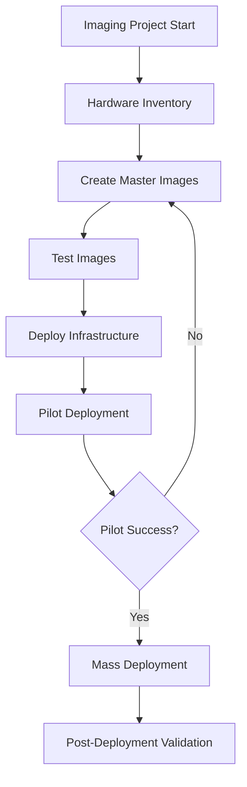
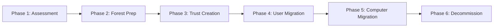

# B2B Enterprise Migration Guide

> Comprehensive guide for enterprise-level migrations including mass device imaging, server migrations, Active Directory, and MDM deployments.

## Table of Contents

1. [Overview](#overview)
2. [Mass Device Imaging](#mass-device-imaging)
3. [Windows Server Migration](#windows-server-migration)
4. [Linux Server Migration](#linux-server-migration)
5. [Active Directory Migration](#active-directory-migration)
6. [Azure AD / Entra ID Integration](#azure-ad--entra-id-integration)
7. [MDM Migration](#mdm-migration)
8. [ERP System Migration](#erp-system-migration)
9. [CRM Platform Migration](#crm-platform-migration)
10. [Legacy System Integration](#legacy-system-integration)
11. [Data Warehouse Migration](#data-warehouse-migration)
12. [Compliance and Security](#compliance-and-security)
13. [User and Identity Migration](#user-and-identity-migration)
14. [Project Planning Templates](#project-planning-templates)
15. [Communication Templates](#communication-templates)

---

## Overview

Enterprise migrations require meticulous planning, stakeholder coordination, and robust rollback procedures. This guide covers the technical and operational aspects of large-scale B2B migrations.

### Enterprise Migration Complexity Matrix

| Migration Type | Complexity | Duration | Risk Level |
|---------------|------------|----------|------------|
| Mass Device Imaging | Medium | 2-4 weeks | Medium |
| Windows Server Migration | High | 4-8 weeks | High |
| Active Directory Migration | Very High | 8-16 weeks | Critical |
| Azure AD Integration | Medium-High | 4-6 weeks | High |
| MDM Platform Migration | Medium | 3-6 weeks | Medium |
| ERP Migration | Very High | 6-18 months | Critical |
| CRM Migration | High | 3-6 months | High |

### Success Criteria

```yaml
enterprise_migration_success_criteria:
  business_continuity:
    - Zero critical system downtime during business hours
    - Maximum 4-hour planned maintenance windows
    - 99.9% uptime SLA maintained

  data_integrity:
    - 100% data validation post-migration
    - Zero data loss tolerance
    - Audit trail preservation

  user_impact:
    - < 2 hours average user downtime
    - Training completion before go-live
    - Help desk coverage during transition

  security:
    - No security regression
    - Compliance maintained throughout
    - Access controls verified
```

---

## Mass Device Imaging

### Imaging Strategy Overview



### Master Image Creation (Windows)

```powershell
# Windows Image Preparation Script
# Run on reference machine before capture

# Disable Windows Search Indexing temporarily
Stop-Service WSearch
Set-Service WSearch -StartupType Disabled

# Clear temporary files
Remove-Item -Path "$env:TEMP\*" -Recurse -Force -ErrorAction SilentlyContinue
Remove-Item -Path "C:\Windows\Temp\*" -Recurse -Force -ErrorAction SilentlyContinue
Remove-Item -Path "C:\Windows\SoftwareDistribution\Download\*" -Recurse -Force

# Clear browser caches
$browserPaths = @(
    "$env:LOCALAPPDATA\Google\Chrome\User Data\Default\Cache",
    "$env:LOCALAPPDATA\Microsoft\Edge\User Data\Default\Cache"
)
foreach ($path in $browserPaths) {
    if (Test-Path $path) {
        Remove-Item -Path "$path\*" -Recurse -Force -ErrorAction SilentlyContinue
    }
}

# Defragment and optimize
Optimize-Volume -DriveLetter C -Defrag -Verbose

# Prepare for Sysprep
Write-Host "Running Sysprep with OOBE and Generalize..."
& "$env:SystemRoot\System32\Sysprep\sysprep.exe" /oobe /generalize /shutdown /unattend:C:\unattend.xml
```

### Unattend.xml Template

```xml
<?xml version="1.0" encoding="utf-8"?>
<unattend xmlns="urn:schemas-microsoft-com:unattend">
    <settings pass="specialize">
        <component name="Microsoft-Windows-Shell-Setup" processorArchitecture="amd64">
            <ComputerName>*</ComputerName>
            <TimeZone>Pacific Standard Time</TimeZone>
            <RegisteredOwner>Company Name</RegisteredOwner>
            <RegisteredOrganization>Company Name</RegisteredOrganization>
        </component>
        <component name="Microsoft-Windows-Deployment" processorArchitecture="amd64">
            <RunSynchronous>
                <RunSynchronousCommand wcm:action="add">
                    <Order>1</Order>
                    <Path>powershell.exe -ExecutionPolicy Bypass -File C:\Setup\PostImage.ps1</Path>
                    <Description>Post-image configuration</Description>
                </RunSynchronousCommand>
            </RunSynchronous>
        </component>
    </settings>
    <settings pass="oobeSystem">
        <component name="Microsoft-Windows-Shell-Setup" processorArchitecture="amd64">
            <OOBE>
                <HideEULAPage>true</HideEULAPage>
                <HideWirelessSetupInOOBE>true</HideWirelessSetupInOOBE>
                <NetworkLocation>Work</NetworkLocation>
                <ProtectYourPC>1</ProtectYourPC>
            </OOBE>
            <UserAccounts>
                <LocalAccounts>
                    <LocalAccount wcm:action="add">
                        <Password>
                            <Value>PLACEHOLDER</Value>
                            <PlainText>false</PlainText>
                        </Password>
                        <Group>Administrators</Group>
                        <Name>localadmin</Name>
                    </LocalAccount>
                </LocalAccounts>
            </UserAccounts>
            <AutoLogon>
                <Password>
                    <Value>PLACEHOLDER</Value>
                    <PlainText>false</PlainText>
                </Password>
                <Enabled>true</Enabled>
                <LogonCount>1</LogonCount>
                <Username>localadmin</Username>
            </AutoLogon>
        </component>
    </settings>
</unattend>
```

### MDT (Microsoft Deployment Toolkit) Task Sequence

```ini
# Task Sequence Configuration
[Settings]
Priority=Default
Properties=MyCustomProperty

[Default]
OSInstall=Y
SkipCapture=YES
SkipAdminPassword=YES
SkipProductKey=YES
SkipComputerBackup=YES
SkipBitLocker=YES

# Computer Naming Convention
OSDComputerName=%SerialNumber%

# Domain Join
JoinDomain=corp.example.com
DomainAdmin=CORP\svc-mdt-join
DomainAdminPassword=********

# Application Installation
Applications001={app-guid-office365}
Applications002={app-guid-chrome}
Applications003={app-guid-vpn-client}
Applications004={app-guid-security-agent}
```

### SCCM OSD Task Sequence Steps

```powershell
# SCCM Task Sequence PowerShell Steps

# Step 1: Pre-flight checks
$diskSpace = (Get-WmiObject Win32_LogicalDisk -Filter "DeviceID='C:'").FreeSpace / 1GB
if ($diskSpace -lt 50) {
    Write-Error "Insufficient disk space: ${diskSpace}GB available"
    exit 1
}

# Step 2: Driver injection based on model
$model = (Get-WmiObject Win32_ComputerSystem).Model
$driverPath = "\\sccm-server\Drivers\$model"
if (Test-Path $driverPath) {
    Write-Host "Applying drivers for: $model"
    pnputil.exe /add-driver "$driverPath\*.inf" /subdirs /install
}

# Step 3: Software installation with retry logic
$applications = @(
    @{Name="Microsoft 365"; MSI="\\server\apps\M365\setup.exe"; Args="/configure configuration.xml"},
    @{Name="Chrome"; MSI="\\server\apps\Chrome\GoogleChromeStandaloneEnterprise64.msi"; Args="/qn"},
    @{Name="VPN Client"; MSI="\\server\apps\VPN\vpn-client.msi"; Args="/qn"}
)

foreach ($app in $applications) {
    $retryCount = 0
    $maxRetries = 3

    while ($retryCount -lt $maxRetries) {
        Write-Host "Installing $($app.Name) (Attempt $($retryCount + 1))"
        $process = Start-Process -FilePath $app.MSI -ArgumentList $app.Args -Wait -PassThru

        if ($process.ExitCode -eq 0 -or $process.ExitCode -eq 3010) {
            Write-Host "$($app.Name) installed successfully"
            break
        }

        $retryCount++
        Start-Sleep -Seconds 30
    }
}
```

---

## Windows Server Migration

### Pre-Migration Assessment

```powershell
# Server Assessment Script
# Run on each source server

$serverReport = @{
    Hostname = $env:COMPUTERNAME
    OS = (Get-WmiObject Win32_OperatingSystem).Caption
    Roles = (Get-WindowsFeature | Where-Object {$_.Installed}).Name
    Services = (Get-Service | Where-Object {$_.StartType -eq 'Automatic' -and $_.Status -eq 'Running'}).Name
    InstalledSoftware = Get-ItemProperty HKLM:\Software\Microsoft\Windows\CurrentVersion\Uninstall\* |
        Select-Object DisplayName, DisplayVersion, Publisher
    NetworkConfig = Get-NetIPConfiguration
    DiskUsage = Get-WmiObject Win32_LogicalDisk | Select-Object DeviceID,
        @{N='SizeGB';E={[math]::Round($_.Size/1GB)}},
        @{N='FreeGB';E={[math]::Round($_.FreeSpace/1GB)}}
    ScheduledTasks = Get-ScheduledTask | Where-Object {$_.State -eq 'Ready'} |
        Select-Object TaskName, TaskPath
    Certificates = Get-ChildItem Cert:\LocalMachine\My
    SharedFolders = Get-WmiObject Win32_Share | Select-Object Name, Path, Description
}

# Export to JSON for migration planning
$serverReport | ConvertTo-Json -Depth 5 | Out-File "C:\Migration\$env:COMPUTERNAME-assessment.json"
```

### Windows Server Role Migration Checklist

```markdown
## File Server Migration

### Pre-Migration
- [ ] Document all shares and permissions
- [ ] Inventory DFS namespaces
- [ ] Record NTFS permissions
- [ ] Identify quotas and FSRM policies
- [ ] Backup server state

### Migration Steps
1. [ ] Install File Server role on target
2. [ ] Configure storage volumes
3. [ ] Use Storage Migration Service or Robocopy
4. [ ] Migrate DFS namespace configuration
5. [ ] Update DNS records
6. [ ] Test file access

### Post-Migration
- [ ] Verify share permissions
- [ ] Test user access from clients
- [ ] Update monitoring
- [ ] Decommission source server

## Print Server Migration

### Pre-Migration
- [ ] Export printer configurations
- [ ] Document driver versions
- [ ] Record port configurations
- [ ] Inventory GPO printer deployments

### Migration
1. [ ] Install Print Server role
2. [ ] Import printer configurations
3. [ ] Update GPO settings
4. [ ] Test print functionality
```

### Hyper-V VM Migration

```powershell
# Live Migration Script for Hyper-V VMs

param(
    [string]$SourceHost = "hyperv01.corp.local",
    [string]$DestHost = "hyperv02.corp.local",
    [string[]]$VMNames
)

# Verify connectivity
Test-Connection $DestHost -Count 1 -ErrorAction Stop

foreach ($vmName in $VMNames) {
    Write-Host "Migrating VM: $vmName"

    # Get VM details
    $vm = Get-VM -ComputerName $SourceHost -Name $vmName

    if ($vm.State -eq 'Running') {
        # Live migration
        Move-VM -ComputerName $SourceHost -Name $vmName `
            -DestinationHost $DestHost `
            -IncludeStorage `
            -DestinationStoragePath "D:\Hyper-V\$vmName" `
            -Verbose
    } else {
        # Offline migration (faster for stopped VMs)
        Export-VM -ComputerName $SourceHost -Name $vmName -Path "\\nas\exports"
        Import-VM -Path "\\nas\exports\$vmName\*.vmcx" -ComputerName $DestHost
    }

    # Verify migration
    $migratedVM = Get-VM -ComputerName $DestHost -Name $vmName -ErrorAction SilentlyContinue
    if ($migratedVM) {
        Write-Host "Successfully migrated: $vmName" -ForegroundColor Green
    } else {
        Write-Error "Migration failed for: $vmName"
    }
}
```

---

## Linux Server Migration

### Server Assessment Script

```bash
#!/bin/bash
# Linux Server Migration Assessment

REPORT_DIR="/tmp/migration-assessment"
mkdir -p "$REPORT_DIR"

HOSTNAME=$(hostname)

echo "=== System Information ===" > "$REPORT_DIR/system-info.txt"
uname -a >> "$REPORT_DIR/system-info.txt"
cat /etc/os-release >> "$REPORT_DIR/system-info.txt"

echo "=== CPU Info ===" >> "$REPORT_DIR/system-info.txt"
lscpu >> "$REPORT_DIR/system-info.txt"

echo "=== Memory ===" >> "$REPORT_DIR/system-info.txt"
free -h >> "$REPORT_DIR/system-info.txt"

# Installed packages
if command -v dpkg &> /dev/null; then
    dpkg --get-selections > "$REPORT_DIR/installed-packages.txt"
elif command -v rpm &> /dev/null; then
    rpm -qa > "$REPORT_DIR/installed-packages.txt"
fi

# Services
systemctl list-units --type=service --state=running > "$REPORT_DIR/running-services.txt"

# Network configuration
ip addr > "$REPORT_DIR/network-config.txt"
ip route >> "$REPORT_DIR/network-config.txt"
cat /etc/resolv.conf >> "$REPORT_DIR/network-config.txt"

# Disk usage
df -h > "$REPORT_DIR/disk-usage.txt"
lsblk >> "$REPORT_DIR/disk-usage.txt"

# Cron jobs
crontab -l > "$REPORT_DIR/crontab.txt" 2>/dev/null
ls -la /etc/cron.d/ >> "$REPORT_DIR/crontab.txt"

# Open ports
ss -tulpn > "$REPORT_DIR/listening-ports.txt"

# Create tarball
tar -czf "/tmp/$HOSTNAME-assessment.tar.gz" -C "$REPORT_DIR" .
echo "Assessment complete: /tmp/$HOSTNAME-assessment.tar.gz"
```

### rsync Migration Script

```bash
#!/bin/bash
# Server-to-server migration using rsync

SOURCE_SERVER="old-server.corp.local"
DEST_SERVER="new-server.corp.local"
EXCLUDE_FILE="/tmp/rsync-exclude.txt"

# Create exclude patterns
cat > "$EXCLUDE_FILE" << 'EOF'
/proc/*
/sys/*
/dev/*
/run/*
/tmp/*
/mnt/*
/media/*
/lost+found
/var/log/*
/var/cache/*
EOF

# Sync system directories
rsync -avzP --delete \
    --exclude-from="$EXCLUDE_FILE" \
    -e "ssh -o StrictHostKeyChecking=no" \
    root@$SOURCE_SERVER:/ \
    /mnt/migration/

# Sync with bandwidth limit (10 MB/s)
rsync -avzP --bwlimit=10000 \
    -e "ssh -o StrictHostKeyChecking=no" \
    root@$SOURCE_SERVER:/data/ \
    /data/
```

---

## Active Directory Migration

### AD Migration Phases



### Forest Trust Configuration

```powershell
# Create Forest Trust between source and target domains

# On Target Forest DC
$sourceForest = "old.corp.local"
$targetForest = "new.corp.local"
$trustPassword = ConvertTo-SecureString "ComplexTrustP@ssw0rd!" -AsPlainText -Force

# Create two-way forest trust
$forest = [System.DirectoryServices.ActiveDirectory.Forest]::GetCurrentForest()
$forestContext = New-Object System.DirectoryServices.ActiveDirectory.DirectoryContext(
    [System.DirectoryServices.ActiveDirectory.DirectoryContextType]::Forest,
    $sourceForest
)

$sourceForestObj = [System.DirectoryServices.ActiveDirectory.Forest]::GetForest($forestContext)

# Create the trust
$forest.CreateTrustRelationship(
    $sourceForestObj,
    [System.DirectoryServices.ActiveDirectory.TrustDirection]::Bidirectional
)

# Verify trust
Get-ADTrust -Filter {Name -eq $sourceForest}
```

### ADMT (Active Directory Migration Tool) Configuration

```ini
# ADMT Migration Options File
[Options]
SourceDomain=old.corp.local
TargetDomain=new.corp.local
TargetOU=OU=MigratedUsers,DC=new,DC=corp,DC=local

# User Migration Settings
MigrateUserPassword=Yes
DisableSourceAccount=Yes
TranslateSecurity=Yes
UpdateUserRights=Yes
MigrateGroups=Yes
FixGroupMembership=Yes

# SID History
SIDHistory=Yes

# Conflict Resolution
ConflictOptions=RenameConflictingObject
RenamePrefixOrSuffix=_migrated
```

### Group Policy Migration

```powershell
# Export GPOs from source domain
$backupPath = "\\fileserver\GPO-Backup"
$sourceGPOs = Get-GPO -All -Domain "old.corp.local"

foreach ($gpo in $sourceGPOs) {
    $backupFolder = Join-Path $backupPath $gpo.DisplayName
    New-Item -ItemType Directory -Path $backupFolder -Force

    Backup-GPO -Guid $gpo.Id -Path $backupFolder -Domain "old.corp.local"

    # Export migration table for security principals
    $gpo | Get-GPOReport -ReportType XML -Path "$backupFolder\report.xml"
}

# Import GPOs to target domain
$migrationTable = "\\fileserver\GPO-Backup\MigrationTable.migtable"

foreach ($gpoFolder in (Get-ChildItem $backupPath -Directory)) {
    $backupInfo = Get-ChildItem "$($gpoFolder.FullName)\*" -Include "*.xml" |
        Select-Object -First 1

    Import-GPO -BackupGpoName $gpoFolder.Name `
        -Path $gpoFolder.FullName `
        -TargetName "$($gpoFolder.Name)_Migrated" `
        -MigrationTable $migrationTable `
        -CreateIfNeeded `
        -Domain "new.corp.local"
}
```

---

## Azure AD / Entra ID Integration

### Hybrid Identity Setup

```powershell
# Azure AD Connect Configuration
# Pre-requisites check

# Check forest functional level
$forest = [System.DirectoryServices.ActiveDirectory.Forest]::GetCurrentForest()
Write-Host "Forest Functional Level: $($forest.ForestMode)"

# Verify UPN suffixes
Get-ADForest | Select-Object UPNSuffixes

# Add UPN suffix if needed
$newUPN = "company.com"
Set-ADForest -Identity (Get-ADForest) -UPNSuffixes @{Add=$newUPN}

# Update user UPNs for cloud sync
Get-ADUser -Filter * -SearchBase "OU=Users,DC=corp,DC=local" | ForEach-Object {
    $newUPN = "$($_.SamAccountName)@company.com"
    Set-ADUser -Identity $_ -UserPrincipalName $newUPN
}

# Configure Azure AD Connect
# Download from: https://www.microsoft.com/en-us/download/details.aspx?id=47594

# Post-install: Configure filtering
# Organizational Unit filtering
Set-ADSyncScheduler -SyncCycleEnabled $false

# Configure OU filtering via wizard or PowerShell
$connector = Get-ADSyncConnector -Name "corp.local"
$rules = Get-ADSyncRule | Where-Object {$_.Connector -eq $connector.Identifier}
```

### Azure AD Application Proxy

```powershell
# Configure Azure AD App Proxy for legacy apps

# Install App Proxy Connector
# Download from Azure Portal > Azure AD > Application proxy > Download connector

# Configure connector groups
$connectorGroup = New-AzureADApplicationProxyConnectorGroup -Name "OnPrem-Apps"

# Publish internal application
$app = New-AzureADApplication -DisplayName "Legacy HR App"

Set-AzureADApplicationProxyApplication -ObjectId $app.ObjectId `
    -ExternalUrl "https://hrapp.company.com" `
    -InternalUrl "http://hrserver.corp.local:8080" `
    -ExternalAuthenticationType AadPreAuthentication `
    -ConnectorGroupId $connectorGroup.Id
```

---

## MDM Migration

### Intune Migration from SCCM

```powershell
# Co-management setup for Intune migration

# Prerequisites
# 1. Azure AD Connect configured
# 2. Azure AD Premium P1 licenses
# 3. Intune subscription

# Enable co-management in SCCM
# Configuration Manager Console > Administration > Cloud Services > Co-management

# Co-management settings
$coManagementSettings = @{
    AutoEnrollment = "Pilot"  # or "All"
    PilotCollection = "CM_Intune_Pilot"
    Workloads = @{
        CompliancePolicies = "Intune"
        ResourceAccessPolicies = "ConfigMgr"
        DeviceConfiguration = "Pilot Intune"
        WindowsUpdatePolicies = "Intune"
        EndpointProtection = "Intune"
        ClientApps = "ConfigMgr"
        OfficeClickToRun = "Intune"
    }
}

# Enrollment status page configuration
$enrollmentConfig = @{
    ShowProgress = $true
    BlockDeviceUntilComplete = $true
    AllowDeviceReset = $true
    AllowLogCollection = $true
    TimeoutMinutes = 60
}
```

### Jamf to Intune Migration (macOS)

```bash
#!/bin/bash
# Jamf to Intune Migration Script

# Phase 1: Prepare device for migration
echo "Preparing device for MDM migration..."

# Remove Jamf management profile
jamf removeFramework

# Clear MDM enrollment
profiles -D -forced

# Phase 2: Enroll in Intune
# Company Portal will be installed via bootstrap package

# Install Intune Company Portal
curl -L -o "/tmp/CompanyPortal.pkg" \
    "https://go.microsoft.com/fwlink/?linkid=853070"

installer -pkg /tmp/CompanyPortal.pkg -target /

# Trigger enrollment
open "companyportal://enrollment"
```

---

## ERP System Migration

### SAP Migration Checklist

```yaml
sap_migration_phases:
  phase_1_assessment:
    duration: "4-6 weeks"
    tasks:
      - Complete system inventory
      - Document customizations (Z-programs, user exits)
      - Analyze data volumes
      - Identify integration points
      - Review licensing requirements

  phase_2_preparation:
    duration: "6-8 weeks"
    tasks:
      - Set up target system landscape
      - Configure network connectivity
      - Prepare data migration tools (LSMW, S/4HANA Migration Cockpit)
      - Create test plans
      - Train migration team

  phase_3_migration:
    duration: "Varies by data volume"
    tasks:
      - Export configuration
      - Migrate master data
      - Migrate transactional data
      - Configure integrations
      - Execute cutover

  phase_4_validation:
    duration: "2-4 weeks"
    tasks:
      - Execute test scripts
      - Verify data integrity
      - Test integrations
      - User acceptance testing
      - Performance testing

  phase_5_go_live:
    tasks:
      - Final data sync
      - Cutover execution
      - Production verification
      - Hypercare support
```

### Data Migration Validation SQL

```sql
-- ERP Data Validation Queries

-- Validate customer master data
SELECT
    'Customers' as entity,
    COUNT(*) as source_count,
    (SELECT COUNT(*) FROM target.customers) as target_count,
    CASE
        WHEN COUNT(*) = (SELECT COUNT(*) FROM target.customers)
        THEN 'PASSED'
        ELSE 'FAILED'
    END as validation_status
FROM source.customers

UNION ALL

-- Validate orders
SELECT
    'Orders' as entity,
    COUNT(*) as source_count,
    (SELECT COUNT(*) FROM target.orders) as target_count,
    CASE
        WHEN COUNT(*) = (SELECT COUNT(*) FROM target.orders)
        THEN 'PASSED'
        ELSE 'FAILED'
    END as validation_status
FROM source.orders

UNION ALL

-- Validate financial totals
SELECT
    'GL Balances' as entity,
    SUM(balance) as source_sum,
    (SELECT SUM(balance) FROM target.gl_accounts) as target_sum,
    CASE
        WHEN ABS(SUM(balance) - (SELECT SUM(balance) FROM target.gl_accounts)) < 0.01
        THEN 'PASSED'
        ELSE 'FAILED'
    END as validation_status
FROM source.gl_accounts;
```

---

## CRM Platform Migration

### Salesforce to HubSpot Migration

```javascript
// Salesforce to HubSpot Data Mapper

const fieldMapping = {
  contacts: {
    'FirstName': 'firstname',
    'LastName': 'lastname',
    'Email': 'email',
    'Phone': 'phone',
    'Title': 'jobtitle',
    'Department': 'department',
    'MailingStreet': 'address',
    'MailingCity': 'city',
    'MailingState': 'state',
    'MailingPostalCode': 'zip',
    'MailingCountry': 'country',
    'Account.Name': 'company',
    'LeadSource': 'hs_lead_source',
    'OwnerId': 'hubspot_owner_id'
  },
  companies: {
    'Name': 'name',
    'Website': 'website',
    'Industry': 'industry',
    'AnnualRevenue': 'annualrevenue',
    'NumberOfEmployees': 'numberofemployees',
    'BillingStreet': 'address',
    'BillingCity': 'city',
    'BillingState': 'state',
    'BillingPostalCode': 'zip',
    'BillingCountry': 'country'
  },
  deals: {
    'Name': 'dealname',
    'Amount': 'amount',
    'CloseDate': 'closedate',
    'StageName': 'dealstage',
    'Probability': 'hs_deal_stage_probability',
    'Type': 'dealtype'
  }
};

// Transform Salesforce record to HubSpot format
function transformRecord(sfRecord, objectType) {
  const mapping = fieldMapping[objectType];
  const hsRecord = {};

  for (const [sfField, hsField] of Object.entries(mapping)) {
    if (sfField.includes('.')) {
      // Handle related object fields
      const [parentObj, field] = sfField.split('.');
      hsRecord[hsField] = sfRecord[parentObj]?.[field] || null;
    } else {
      hsRecord[hsField] = sfRecord[sfField] || null;
    }
  }

  return hsRecord;
}
```

---

## Compliance and Security

### SOC 2 Compliance During Migration

```yaml
soc2_migration_controls:
  security:
    - name: "Access Control Maintenance"
      description: "Maintain access controls during migration"
      evidence:
        - Access review logs
        - Permission change documentation
        - Approval records

    - name: "Data Encryption in Transit"
      description: "All migration data encrypted during transfer"
      evidence:
        - TLS certificate verification
        - Network capture showing encryption
        - Migration tool encryption settings

  availability:
    - name: "Backup Verification"
      description: "Verified backups before migration"
      evidence:
        - Backup logs
        - Test restore results
        - Backup integrity checks

    - name: "Rollback Capability"
      description: "Documented and tested rollback procedures"
      evidence:
        - Rollback procedure document
        - Rollback test results
        - Recovery time measurements

  confidentiality:
    - name: "Data Classification"
      description: "Sensitive data identified and protected"
      evidence:
        - Data classification inventory
        - DLP policy configurations
        - Encryption verification

  processing_integrity:
    - name: "Data Validation"
      description: "Data integrity verified post-migration"
      evidence:
        - Checksum comparisons
        - Record count validation
        - Sample data verification
```

### GDPR/HIPAA Data Handling

```python
# Data Masking for Migration
import hashlib
from typing import Any, Dict

class DataMasker:
    """Mask sensitive data during migration while maintaining referential integrity."""

    def __init__(self, salt: str):
        self.salt = salt
        self._cache = {}

    def mask_pii(self, value: str, field_type: str) -> str:
        """Mask PII while maintaining format and referential integrity."""

        if not value:
            return value

        cache_key = f"{field_type}:{value}"
        if cache_key in self._cache:
            return self._cache[cache_key]

        if field_type == 'email':
            masked = self._mask_email(value)
        elif field_type == 'ssn':
            masked = self._mask_ssn(value)
        elif field_type == 'phone':
            masked = self._mask_phone(value)
        elif field_type == 'name':
            masked = self._mask_name(value)
        else:
            masked = self._hash_value(value)

        self._cache[cache_key] = masked
        return masked

    def _hash_value(self, value: str) -> str:
        """Create consistent hash for referential integrity."""
        return hashlib.sha256(f"{self.salt}{value}".encode()).hexdigest()[:12]

    def _mask_email(self, email: str) -> str:
        """Mask email while preserving domain structure."""
        if '@' not in email:
            return f"masked_{self._hash_value(email)}@example.com"

        local, domain = email.split('@')
        return f"user_{self._hash_value(email)[:8]}@{domain}"

    def _mask_ssn(self, ssn: str) -> str:
        """Mask SSN with XXX-XX-XXXX format."""
        digits = ''.join(filter(str.isdigit, ssn))
        return f"XXX-XX-{digits[-4:] if len(digits) >= 4 else '0000'}"

    def _mask_phone(self, phone: str) -> str:
        """Mask phone preserving area code format."""
        digits = ''.join(filter(str.isdigit, phone))
        if len(digits) >= 10:
            return f"({digits[:3]}) XXX-XXXX"
        return "XXX-XXX-XXXX"

    def _mask_name(self, name: str) -> str:
        """Replace name with consistent pseudonym."""
        hash_val = self._hash_value(name)
        first_names = ['John', 'Jane', 'Alex', 'Sam', 'Chris', 'Pat', 'Morgan', 'Taylor']
        last_names = ['Smith', 'Johnson', 'Williams', 'Brown', 'Jones', 'Davis', 'Miller']

        first_idx = int(hash_val[:4], 16) % len(first_names)
        last_idx = int(hash_val[4:8], 16) % len(last_names)

        return f"{first_names[first_idx]} {last_names[last_idx]}"


# Usage example
masker = DataMasker(salt="your-secret-salt")
masked_data = {
    'email': masker.mask_pii('john.doe@company.com', 'email'),
    'ssn': masker.mask_pii('123-45-6789', 'ssn'),
    'name': masker.mask_pii('John Doe', 'name')
}
```

---

## User and Identity Migration

### SSO/SAML Configuration

```xml
<!-- SAML Identity Provider Metadata Template -->
<?xml version="1.0" encoding="UTF-8"?>
<EntityDescriptor
    xmlns="urn:oasis:names:tc:SAML:2.0:metadata"
    entityID="https://idp.company.com">

    <IDPSSODescriptor
        protocolSupportEnumeration="urn:oasis:names:tc:SAML:2.0:protocol"
        WantAuthnRequestsSigned="true">

        <KeyDescriptor use="signing">
            <KeyInfo xmlns="http://www.w3.org/2000/09/xmldsig#">
                <X509Data>
                    <X509Certificate>CERTIFICATE_DATA</X509Certificate>
                </X509Data>
            </KeyInfo>
        </KeyDescriptor>

        <SingleLogoutService
            Binding="urn:oasis:names:tc:SAML:2.0:bindings:HTTP-Redirect"
            Location="https://idp.company.com/slo"/>

        <NameIDFormat>urn:oasis:names:tc:SAML:1.1:nameid-format:emailAddress</NameIDFormat>

        <SingleSignOnService
            Binding="urn:oasis:names:tc:SAML:2.0:bindings:HTTP-Redirect"
            Location="https://idp.company.com/sso"/>
    </IDPSSODescriptor>
</EntityDescriptor>
```

### SCIM User Provisioning

```python
# SCIM 2.0 User Provisioning
from dataclasses import dataclass
from typing import List, Optional
import requests

@dataclass
class SCIMUser:
    """SCIM 2.0 User representation."""
    userName: str
    email: str
    givenName: str
    familyName: str
    active: bool = True
    groups: Optional[List[str]] = None

    def to_scim_dict(self) -> dict:
        """Convert to SCIM 2.0 format."""
        return {
            "schemas": ["urn:ietf:params:scim:schemas:core:2.0:User"],
            "userName": self.userName,
            "name": {
                "givenName": self.givenName,
                "familyName": self.familyName
            },
            "emails": [
                {
                    "primary": True,
                    "value": self.email,
                    "type": "work"
                }
            ],
            "active": self.active
        }


class SCIMClient:
    """SCIM 2.0 client for user provisioning."""

    def __init__(self, base_url: str, token: str):
        self.base_url = base_url.rstrip('/')
        self.headers = {
            'Authorization': f'Bearer {token}',
            'Content-Type': 'application/scim+json'
        }

    def create_user(self, user: SCIMUser) -> dict:
        """Create a new user via SCIM."""
        response = requests.post(
            f"{self.base_url}/Users",
            json=user.to_scim_dict(),
            headers=self.headers
        )
        response.raise_for_status()
        return response.json()

    def update_user(self, user_id: str, user: SCIMUser) -> dict:
        """Update existing user via SCIM."""
        response = requests.put(
            f"{self.base_url}/Users/{user_id}",
            json=user.to_scim_dict(),
            headers=self.headers
        )
        response.raise_for_status()
        return response.json()

    def delete_user(self, user_id: str) -> None:
        """Delete user via SCIM (deprovisioning)."""
        response = requests.delete(
            f"{self.base_url}/Users/{user_id}",
            headers=self.headers
        )
        response.raise_for_status()

    def get_users(self, filter_query: str = None) -> List[dict]:
        """List users with optional filtering."""
        params = {'filter': filter_query} if filter_query else {}
        response = requests.get(
            f"{self.base_url}/Users",
            params=params,
            headers=self.headers
        )
        response.raise_for_status()
        return response.json().get('Resources', [])
```

---

## Project Planning Templates

### Migration Project Charter

```markdown
# Migration Project Charter

## Project Overview
**Project Name:** [System/Platform Name] Migration
**Project Sponsor:** [Name, Title]
**Project Manager:** [Name, Title]
**Start Date:** [Date]
**Target Completion:** [Date]

## Business Justification
[Describe why this migration is necessary]

## Objectives
1. [Primary objective]
2. [Secondary objective]
3. [Additional objectives]

## Scope

### In Scope
- [List items in scope]

### Out of Scope
- [List items explicitly excluded]

## Success Criteria
| Metric | Target | Measurement Method |
|--------|--------|-------------------|
| Downtime | < X hours | Monitoring logs |
| Data Integrity | 100% | Validation scripts |
| User Adoption | > 90% | Training completion |

## Budget
| Category | Estimated Cost |
|----------|---------------|
| Hardware/Infrastructure | $X |
| Software/Licensing | $X |
| Professional Services | $X |
| Training | $X |
| Contingency (15%) | $X |
| **Total** | $X |

## Key Risks
| Risk | Probability | Impact | Mitigation |
|------|-------------|--------|------------|
| [Risk 1] | High/Med/Low | High/Med/Low | [Strategy] |

## Stakeholders
| Name | Role | Responsibility |
|------|------|----------------|
| [Name] | [Title] | [What they do] |

## Approval Signatures
| Role | Name | Signature | Date |
|------|------|-----------|------|
| Project Sponsor | | | |
| IT Director | | | |
| Business Owner | | | |
```

### Risk Assessment Matrix

```yaml
risk_assessment:
  categories:
    technical:
      - id: "TECH-001"
        risk: "Data corruption during migration"
        probability: "Medium"
        impact: "Critical"
        mitigation:
          - Implement checksums on all data transfers
          - Maintain synchronized backup until validation complete
          - Test restore procedures before migration
        owner: "Database Team Lead"
        status: "Open"

      - id: "TECH-002"
        risk: "Integration failures with dependent systems"
        probability: "High"
        impact: "High"
        mitigation:
          - Map all integration points
          - Create integration test suite
          - Schedule integration testing window
        owner: "Integration Architect"
        status: "Open"

    operational:
      - id: "OPS-001"
        risk: "Extended downtime exceeding maintenance window"
        probability: "Medium"
        impact: "High"
        mitigation:
          - Practice migration in test environment
          - Create detailed runbook with time estimates
          - Define go/no-go checkpoints
        owner: "Operations Manager"
        status: "Open"

    resource:
      - id: "RES-001"
        risk: "Key personnel unavailable during migration"
        probability: "Low"
        impact: "High"
        mitigation:
          - Cross-train team members
          - Document all procedures
          - Identify backup resources
        owner: "Project Manager"
        status: "Open"
```

---

## Communication Templates

### Migration Announcement

```markdown
# [Company Name] System Migration Notice

**Date:** [Date]
**To:** All [Department/Company] Staff
**From:** IT Department
**Subject:** Upcoming Migration of [System Name]

## Overview
We are upgrading [System Name] to improve [performance/security/features].
This change will occur on [Date/Time].

## What's Changing
- [Change 1]
- [Change 2]
- [Change 3]

## Timeline
| Phase | Date | Impact |
|-------|------|--------|
| Preparation | [Date] | None |
| Migration | [Date/Time] | System unavailable |
| Validation | [Date] | Limited access |
| Go-Live | [Date] | Full access restored |

## What You Need to Do
1. **Before Migration:**
   - Save all work and close [System Name] by [Time]
   - [Additional instructions]

2. **During Migration:**
   - The system will be unavailable from [Start] to [End]
   - [Alternative procedures if applicable]

3. **After Migration:**
   - Log in with your existing credentials
   - [New features/changes to note]

## Support
If you experience issues after the migration:
- **Help Desk:** [Phone/Email]
- **Hours:** [Support hours]
- **Self-Service:** [Knowledge base URL]

## Questions?
Contact: [Name] at [Email]

---
*Thank you for your patience during this upgrade.*
```

### Go-Live Communication

```markdown
# [System Name] Migration - Go-Live Confirmation

**Status:** ✅ SUCCESSFUL
**Completion Time:** [Date/Time]
**Downtime:** [Actual hours]

## Migration Summary
The migration of [System Name] has been completed successfully.

### Completed Items
- ✅ Data migration (X records)
- ✅ Configuration migration
- ✅ Integration testing
- ✅ User acceptance testing
- ✅ Security verification

### Key Metrics
| Metric | Target | Actual | Status |
|--------|--------|--------|--------|
| Downtime | < X hrs | X hrs | ✅ |
| Data Validation | 100% | 100% | ✅ |
| Integration Tests | Pass | Pass | ✅ |

## Action Required
- Log into [System Name] using your regular credentials
- Verify your recent data and settings
- Report any issues to Help Desk immediately

## Known Issues
[List any known issues or temporary limitations]

## Support
Help Desk is on extended hours this week:
- **Phone:** [Number]
- **Email:** [Email]
- **Hours:** [Extended hours]

---
*Migration Team: [Names]*
```

---

## Rollback Procedures

### Emergency Rollback Checklist

```yaml
rollback_procedure:
  trigger_conditions:
    - "Critical data corruption detected"
    - "System functionality significantly impaired"
    - "Security breach identified"
    - "Business operations cannot continue"

  decision_authority:
    - "Project Sponsor approval required"
    - "IT Director must be notified"
    - "Document decision and reasoning"

  steps:
    - step: 1
      action: "Announce rollback initiation"
      responsible: "Project Manager"
      time: "5 minutes"
      details:
        - Send emergency notification to stakeholders
        - Update status page

    - step: 2
      action: "Stop new transactions"
      responsible: "Operations Team"
      time: "10 minutes"
      details:
        - Disable user access to new system
        - Queue incoming requests

    - step: 3
      action: "Capture current state"
      responsible: "Database Team"
      time: "30 minutes"
      details:
        - Backup any new data created
        - Document delta changes

    - step: 4
      action: "Restore previous system"
      responsible: "Infrastructure Team"
      time: "Variable"
      details:
        - Restore from verified backup
        - Verify system integrity
        - Restore network configurations

    - step: 5
      action: "Validate restoration"
      responsible: "QA Team"
      time: "60 minutes"
      details:
        - Run validation scripts
        - Test critical functions
        - Verify integrations

    - step: 6
      action: "Re-enable access"
      responsible: "Operations Team"
      time: "15 minutes"
      details:
        - Update DNS if needed
        - Enable user access
        - Monitor for issues

    - step: 7
      action: "Post-rollback communication"
      responsible: "Project Manager"
      time: "30 minutes"
      details:
        - Notify all stakeholders
        - Schedule post-mortem
        - Update project documentation
```

---

## Testing and Validation Checklists

### Pre-Migration Testing

```yaml
pre_migration_tests:
  infrastructure:
    - test: "Network connectivity between source and target"
      command: "Test-NetConnection -ComputerName target -Port 443"
      expected: "TcpTestSucceeded: True"

    - test: "Storage capacity verification"
      command: "Get-WmiObject Win32_LogicalDisk | Select-Object DeviceID, FreeSpace"
      expected: "> 50GB free space"

    - test: "Backup verification"
      command: "Test-Backup -Latest"
      expected: "Backup valid and restorable"

  data:
    - test: "Source data integrity check"
      query: "SELECT COUNT(*), CHECKSUM_AGG(CHECKSUM(*)) FROM table_name"
      document: "Record baseline for comparison"

    - test: "Data volume estimation"
      query: "SELECT COUNT(*) as records, SUM(DATALENGTH(*))/1024/1024 as size_mb FROM table"
      document: "Record for migration planning"

  application:
    - test: "Current system functionality baseline"
      method: "Execute regression test suite"
      document: "Record pass/fail status"

    - test: "Integration endpoint availability"
      method: "Test all API endpoints"
      document: "Record response times"
```

### Post-Migration Validation

```yaml
post_migration_validation:
  data_integrity:
    - validation: "Record count comparison"
      source_query: "SELECT COUNT(*) FROM source.table"
      target_query: "SELECT COUNT(*) FROM target.table"
      tolerance: "0%"

    - validation: "Checksum verification"
      source_query: "SELECT CHECKSUM_AGG(CHECKSUM(*)) FROM source.table"
      target_query: "SELECT CHECKSUM_AGG(CHECKSUM(*)) FROM target.table"
      tolerance: "Must match"

    - validation: "Sample data verification"
      method: "Compare 1000 random records"
      tolerance: "100% match"

  functional:
    - validation: "User login"
      steps:
        - "Navigate to login page"
        - "Enter valid credentials"
        - "Verify successful authentication"
      expected: "User authenticated and redirected to dashboard"

    - validation: "Core workflow execution"
      steps:
        - "Create new record"
        - "Modify record"
        - "Delete record"
        - "Search for record"
      expected: "All CRUD operations successful"

    - validation: "Report generation"
      steps:
        - "Run standard reports"
        - "Compare output with pre-migration baseline"
      expected: "Reports match baseline data"

  performance:
    - validation: "Response time"
      method: "Load test with baseline traffic"
      expected: "< 10% degradation from baseline"

    - validation: "Throughput"
      method: "Transaction volume test"
      expected: "Meet or exceed baseline"
```

---

## Post-Migration Support

### Hypercare Support Plan

```yaml
hypercare_support:
  duration: "2 weeks post go-live"

  team_structure:
    tier_1:
      name: "Help Desk"
      hours: "Extended: 6 AM - 10 PM"
      responsibilities:
        - First-line user support
        - Basic troubleshooting
        - Issue escalation

    tier_2:
      name: "Application Support"
      hours: "On-call 24/7"
      responsibilities:
        - Complex issue resolution
        - Configuration changes
        - Performance monitoring

    tier_3:
      name: "Migration Team"
      hours: "On-call 24/7"
      responsibilities:
        - Critical issue resolution
        - Rollback decisions
        - Vendor coordination

  escalation_matrix:
    - severity: "Critical"
      description: "System down, all users affected"
      response: "15 minutes"
      resolution: "4 hours"
      escalation: "Immediate to Tier 3"

    - severity: "High"
      description: "Major function impaired, many users affected"
      response: "30 minutes"
      resolution: "8 hours"
      escalation: "1 hour to Tier 2"

    - severity: "Medium"
      description: "Function impaired, workaround available"
      response: "2 hours"
      resolution: "24 hours"
      escalation: "4 hours to Tier 2"

    - severity: "Low"
      description: "Minor issue, minimal impact"
      response: "8 hours"
      resolution: "72 hours"
      escalation: "Standard process"

  daily_activities:
    - "Morning standup (9 AM)"
    - "System health review"
    - "Open ticket review"
    - "User feedback collection"
    - "Performance metrics review"
    - "Evening summary report (6 PM)"
```

---

*Last Updated: January 2026*
*Version: 1.0*
*Author: ProjectX Migration Team*
