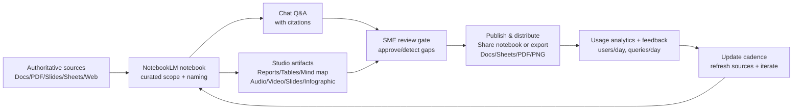
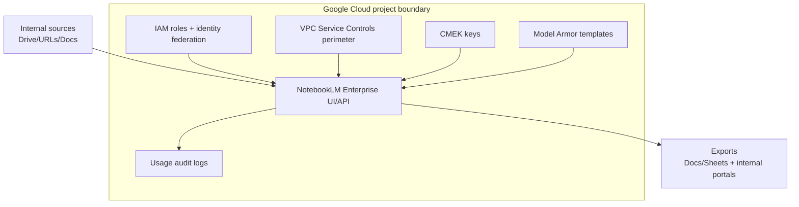

# NotebookLM Use-Case Atlas for AIaaS Leadership and entity["company","INTINC.com","intinc corporate domain"]

## Executive summary
NotebookLM is best understood as a **source-grounded knowledge work instrument**: it turns *curated, authoritative inputs* into **verifiable Q&A and reusable artifacts** (reports, tables, mind maps, audio/video, slides) with citations, and—at enterprise tier—adds **automation + compliance controls** appropriate for scaled internal deployment. citeturn12search4turn11view0turn21view0turn21view5  
This report delivers a **500–use-case catalog (with prompts, personas, inputs/outputs, complexity, benefits, risks)** plus a **balanced “top 50” AIaaS-leadership subset** with actions, resource estimates, and KPIs, aligned to the cross-functional roles you listed. citeturn11view0turn10view0turn21view0  

## NotebookLM capability model relevant to enterprise-grade use cases
NotebookLM’s functional “surface area” is unusually broad for a single product: (a) ingest and curate sources, (b) ask questions grounded strictly in those sources (with inline citations), (c) transform sources into multiple output modalities, (d) share and measure usage, and (e) in the enterprise tier, apply IAM/VPC-SC/CMEK/Model Armor/audit logging and automate via APIs. citeturn11view0turn12search4turn21view0turn21view5turn21view6turn23search0turn23search1  

### Core primitives and constraints
NotebookLM’s most important primitives (because they inform *every* use case in the catalog):

- **Source-grounded chat with inline citations**: NotebookLM answers using direct snippets from your sources, letting users validate accuracy by jumping to quoted context. citeturn12search4turn11view0  
- **Notebook isolation**: each notebook is independent; NotebookLM can’t access information across multiple notebooks simultaneously (a major architecture constraint for enterprise knowledge design). citeturn11view0  
- **Studio outputs** (generated from your sources): **Reports** (custom + templates like FAQ / study guide / briefing doc / timeline), **data tables** (exportable), **mind maps**, **audio/video overviews**, **slide decks**, and **infographics**—with explicit export paths to Docs/Sheets for downstream workflows. citeturn11view0turn6search15turn18view0turn6search0turn6search1turn6search2  
- **Deep Research + source discovery**: NotebookLM can discover web sources and produce source-grounded research reports; Deep Research explicitly generates a research plan and browses many sites, and can add the report + sources back into your notebook for continued work. citeturn9search0turn14view2turn12search20  
- **Customization and steerability**: users can set “goals” for chat (role/voice/objective) per notebook. citeturn14view1  
- **Sharing and measurement**: notebooks can be shared, and usage analytics report *users per day* and *queries per day* once sharing/activity thresholds are met; analytics update ~every 24 hours. citeturn11view0  
- **Known limitations and correctness warnings**: (1) if the answer isn’t present in sources, NotebookLM may not answer, (2) media outputs (audio/video/infographics/slides) can contain factual or visual inaccuracies, and (3) NotebookLM includes explicit cautions against reliance for professional advice. citeturn12search4turn6search0turn6search1turn6search2turn11view0turn10view1  

### Enterprise-only controls and automation building blocks
For a future AIaaS department head, the distinguishing factor is **NotebookLM Enterprise**:

- **Enterprise data boundary**: data stays within your Google Cloud project and can’t be shared externally (vs. consumer public notebooks). citeturn21view0turn10view1  
- **Compliance posture and admin features**: NotebookLM Enterprise is positioned explicitly as “highly compliant” compared to the personal version, including support for VPC Service Controls (VPC-SC). citeturn21view0turn21view5  
- **IAM roles + identity integration**: supports Cloud Identity or federated IdPs (including Microsoft Entra ID / Okta / Ping / SAML/OIDC) via Workforce Identity Federation; users are granted roles such as `Cloud NotebookLM User`. citeturn21view3turn21view4turn21view1  
- **VPC Service Controls**: VPC-SC fully supports NotebookLM Enterprise via the `discoveryengine.googleapis.com` service and reports “no known limitations.” citeturn21view5  
- **Customer-managed encryption keys (CMEK)**: supported, with meaningful operational constraints (e.g., keys can’t be changed/rotated; unprotected notebooks can’t later be protected). citeturn21view6  
- **Model Armor**: available for prompt/response screening; enabling it requires specific roles (Discovery Engine Admin + Model Armor roles). citeturn22search3turn23search0  
- **Audit logging**: admins can configure usage audit logging (through API) to track user operations/metadata for auditing and observability. citeturn23search1  
- **APIs**: NotebookLM Enterprise exposes APIs to create/manage notebooks, manage sources, and generate audio overviews; endpoints are regionalized (`global`, `us`, `eu`) and run via Discovery Engine. citeturn5search16turn3view2turn0search11  

image_group{"layout":"carousel","aspect_ratio":"16:9","query":["NotebookLM Studio panel screenshot","NotebookLM mind map screenshot","NotebookLM audio overview interface screenshot","NotebookLM Deep Research button screenshot"],"num_per_query":1}

### Evidence on reliability
Even with grounding, LLM-based “document Q&A” tools can still generate unsupported interpretations. A 2025 newsroom-style evaluation reported **lower hallucination rates for NotebookLM vs. ChatGPT/Gemini** in their setup, but found a recurring failure mode: **interpretive overconfidence** (turning attributed opinions into general statements). citeturn5academia38  
This matters operationally: many high-impact enterprise use cases should be designed with **review gates**, **citation enforcement**, and **“unknown/not in sources” as a valid output**. citeturn12search4turn11view0turn5academia38  

## Use-case taxonomy and catalog deliverables
The 500-use-case catalog is organized into 13 categories aligned to enterprise workflows and the role coverage you requested (engineering, product, sales, marketing, customer success, legal/compliance, HR, exec leadership). The distribution is intentionally skewed toward categories that tend to dominate enterprise AI workload volume: research/knowledge ops, developer productivity, and executive decision support. citeturn11view0turn14view2turn21view0  

**Downloadables (complete deliverables):**
- [Download: Top 500 use cases (CSV)](sandbox:/mnt/data/notebooklm_top500_use_cases_catalog.csv)  
- [Download: Top 500 use cases (JSONL)](sandbox:/mnt/data/notebooklm_top500_use_cases_catalog.jsonl)  
- [Download: Top 50 AIaaS leadership subset (CSV)](sandbox:/mnt/data/notebooklm_top50_aiaas_leadership_use_cases.csv)  
- [Download: Combined workbook (Excel, 3 sheets)](sandbox:/mnt/data/notebooklm_use_cases_catalog_and_top50.xlsx)  
- [Download: Category distribution chart (PNG)](sandbox:/mnt/data/notebooklm_use_case_category_distribution.png)

### How the “top 500” list was derived
Because no authoritative source publishes “the top 500 NotebookLM use cases,” this catalog is a **rigorous synthesis** grounded in documented capabilities and enterprise controls:

- Capability basis: source ingestion, grounded chat with citations, Studio artifacts (reports/tables/mind maps/audio/video/slides/infographics), Deep Research & web discovery, sharing/analytics, and enterprise IAM/VPC-SC/CMEK/Model Armor/audit logging/APIs. citeturn11view0turn12search4turn14view2turn10view0turn21view0turn21view5turn21view6turn23search0turn23search1  
- Enumeration method: a structured matrix across (persona × workflow stage × artifact modality × governance posture), then curated to 500 unique, enterprise-relevant entries. citeturn11view0turn18view0turn6search0turn6search1turn6search2  
- Risk model: each use case includes a correctness + governance risk note consistent with NotebookLM’s own warnings about AI-generated inaccuracies and “not in sources” behavior. citeturn6search0turn6search2turn11view0turn12search4  

### Prompt template library you can reuse across many use cases
```text
### 1) Strict source-grounded answering (default for enterprise)
Using ONLY the selected sources, answer my question. 
- Cite at least one source snippet for every non-trivial claim.
- If the answer is not in the sources, say: "Not in sources" and list what evidence would be needed.
- Flag contradictions between sources explicitly.

### 2) Decision memo generator (exec-ready)
Create a 1-page decision memo:
Context → Options (2–3) → Recommendation → Trade-offs → Risks/Assumptions → Next steps.
Cite each key claim and include a short "Evidence Index" with 5–10 supporting quotes.

### 3) Gap + contradiction finder (great for governance, product, security)
Scan all sources and produce:
A) Contradictions (quote both sides)
B) Gaps / missing requirements
C) Ambiguous terms or undefined metrics
D) High-risk assumptions
End with: "Minimum additional sources needed" (a short list).

### 4) Data-table extraction for Sheets
Create a data table with:
Row ID | Item | Key claim | Evidence quote | Source | Date (if present) | Confidence (H/M/L).
Make the table export-ready (clean columns, no prose).

### 5) Training kit generator (onboarding / compliance)
Generate:
- A study guide (outline + glossary)
- 25 flashcards with explanations
- 15-question quiz (medium difficulty) with citations
- A "what the sources do NOT say" section
```

### Screenshot and UI reference links
```text
Official blog images (examples; open in a browser):
https://storage.googleapis.com/gweb-uniblog-publish-prod/images/DeepResearch_BlogHeader_2096x1182.width-200.format-webp.webp
https://storage.googleapis.com/gweb-uniblog-publish-prod/images/notebookLM_v2_1.width-200.format-webp.webp
https://storage.googleapis.com/gweb-uniblog-publish-prod/images/FINAL_FOR_BLOG.width-100.format-webp.webp

Official UI and feature references (pages with screenshots and step-by-step):
- NotebookLM Help Center main index (features + limits)
- “Create a notebook in NotebookLM”
- “Generate Audio Overview / Video Overviews / Slide Deck / Infographic”
- “Use Mind Maps”
```
(Feature pages and limits are documented in the NotebookLM Help Center articles cited throughout this report.) citeturn6search4turn11view0turn18view0turn6search0turn6search1turn6search2turn6search15  

## High-impact AIaaS leadership subset and INTINC role mapping
This section focuses on the “AIaaS department head” lens: **repeatable value at scale**, **governance and auditability**, and **integration pathways** (manual → team workflows → automated pipelines). NotebookLM’s own product positioning reinforces these enterprise uses: “single reference point,” targeted Q&A from defined sources, automated documents (FAQs/timelines/study guides), and audio transformations. citeturn5search13turn21view0turn10view0  

### Top 50 AIaaS leadership subset
The balanced Top 50 set is included as a downloadable table with: title, persona, inputs/outputs, complexity, benefits/risks, **recommended next-step actions**, **resource estimates**, and **KPIs**.  
[Download: Top 50 AIaaS leadership subset (CSV)](sandbox:/mnt/data/notebooklm_top50_aiaas_leadership_use_cases.csv)

What “high-impact” means here (practically):
- **Leverage**: one notebook/artifact serves many users (shared, reusable, measurable). citeturn11view0turn10view0  
- **Risk-bounded**: citation checking + review gates + permissible sharing are built-in. citeturn12search4turn11view0turn10view1turn21view0  
- **Scalable**: can evolve into API-driven provisioning, compliant perimeters, and monitoring. citeturn5search16turn21view5turn23search1  

### Role mapping for entity["company","INTINC.com","intinc corporate domain"] employees
Below are **starter notebook archetypes** and the most direct “first deployments” of NotebookLM by role, aligned to the product’s documented capabilities (source grounding, Studio outputs, sharing, and—where needed—enterprise controls). citeturn11view0turn12search4turn10view0turn21view0  

| INTINC role | Best “week-one” notebook archetype | Value focus | Recommended Studio output(s) |
|---|---|---|---|
| Engineering (platform/backend/SRE) | **On-call / Runbook notebook** | Faster MTTR, consistent troubleshooting | Timeline + Data Tables + Chat Q&A + Critique citeturn11view0turn12search4 |
| Product | **PRD / Spec decision notebook** | Reduce requirements drift; speed alignment | Briefing Doc + Data Tables + Custom Report citeturn11view0 |
| Sales / Sales Eng | **Deal-room notebook** (RFP + security + positioning) | Faster RFPs, consistent claims | FAQ + Data Tables + Slide Deck citeturn11view0turn6search1 |
| Marketing | **Launch notebook** (positioning + proof points + assets) | Message consistency; content velocity | Slide Deck + Infographic + FAQ citeturn6search1turn6search2 |
| Customer success / support | **Support taxonomy notebook** | Deflection + faster response | FAQ + Timeline + Data Tables + Audio Brief citeturn11view0turn18view0 |
| Legal / compliance | **Policy + contract clause notebook** | Reduce cycle time; audit readiness | Data Tables + Custom Report + FAQ citeturn11view0 |
| HR / recruiting | **Hiring & onboarding notebook** | Faster onboarding; consistent interviews | Study Guide + Flashcards/Quizzes + FAQ citeturn11view0turn7search3 |
| Executive leadership | **Executive operating notebook** (QBR/board/OKRs) | Faster synthesis; traceability | Briefing Doc + Slide Deck + Data Tables + Audio Deep Dive citeturn11view0turn18view0turn6search1 |

### Enterprise adoption notes and what they imply operationally
A real adoption pattern that reliably predicts value is **“reduce dependency on the ‘company expert’ by centralizing canonical sources.”** In the entity["company","Sonata Design","design firm canada"] case study, NotebookLM supported a centralized store of up-to-date product specs/technical details to reduce expert interruptions and improve self-service efficiency. citeturn17view0  
A direct, operationalizable signal from that story is the cultural shift captured by a short quote: “If you haven’t asked NotebookLM, don’t ask [the expert].” citeturn17view0  
The same pattern generalizes well to AIaaS organizations: define **authoritative sources**, enforce **citation discipline**, and measure whether notebooks reduce repetitive SME load. citeturn12search4turn11view0turn17view0  

## Implementation patterns, integrations, and deployment architectures
This section answers: “If we treat NotebookLM as a platform capability in an AIaaS department, what are the repeatable ways to deploy it?”

### Top implementation patterns
| Pattern | What it is | When it’s strongest | Typical roles | Complexity |
|---|---|---|---|---|
| Canonical “single reference point” notebook | Curated sources + citation-first Q&A | Policy/process/doc sprawl | All roles | Low citeturn12search4turn5search13 |
| Briefing-pack factory | Briefing docs + custom reports exported to Docs | Exec updates; decision cycles | Product/Exec | Low citeturn11view0 |
| FAQ-first self-service | FAQ output + shared viewers | Repeated questions (support, HR, GRC) | Support/HR/GRC | Low citeturn11view0 |
| Timeline reconstruction | Timeline reports for incidents/projects | Postmortems, audits, launches | Eng/GRC/PMO | Medium citeturn11view0 |
| Table-first extraction | Data tables exported to Sheets | Comparing vendors, clauses, KPIs | Sales/Legal/Data | Medium citeturn11view0 |
| Visual synthesis | Mind maps + infographics | Communicating complexity quickly | Exec/Marketing | Medium citeturn6search15turn6search2 |
| Narrative audio/video | Audio/Video overview | Distribution + engagement | Exec/L&D | Medium citeturn18view0turn6search0 |
| Deep Research enrichment loop | Deep Research → import sources → synthesize | Market/tech scouting | Product/R&D | Medium citeturn14view2turn12search20 |
| Shared notebook with analytics | Share + measure usage over 7 days | Internal enablement products | AIaaS/Enablement | Medium citeturn11view0turn10view0 |
| API-provisioned notebook pipeline | Automated notebooks per project/deal/account | Scale, repeatability, governance | AI platform/IT | High citeturn5search16turn3view2turn0search11 |

### Tooling integrations that matter in practice
| Integration | Mechanism | Why it matters | Notes / limitations |
|---|---|---|---|
| Drive-native sources | Import Google Docs/Slides from Drive | Minimizes friction; keeps sources canonical | Workspace positioning emphasizes Workspace integration. citeturn16view0 |
| Web source discovery | Search question → “Web” sources | Faster bibliographies; adds external context | Discover Sources + Deep Research workflows exist. citeturn9search0turn14view2turn12search20 |
| Deep Research agent | “Deep Research” toggle + report import | Produces research plan + sourced report | Runs in background; you can keep adding sources. citeturn14view2turn12search20 |
| Export to Docs / Sheets | Reports → Docs; Tables → Sheets | Connects outputs to workflow tools | Citations appear in Sheets second tab for tables. citeturn11view0 |
| Mobile “share to NotebookLM” | Share a web/PDF/YouTube into notebook | Captures sources in the flow of work | Mobile app has feature limitations vs desktop. citeturn10view2turn12search18 |
| YouTube / audio sources | Use transcripts and audio ingestion | Turns media into searchable sources | Audio/video outputs still require validation. citeturn11view0turn18view0 |
| NotebookLM Enterprise API | Discovery Engine API methods | Automation, provisioning, standardization | Multi-region endpoints and auth required. citeturn3view2turn0search11turn5search16 |
| Enterprise identity | Cloud Identity or Workforce Identity Federation | Central access control | Supports IdPs like Entra/Okta/Ping. citeturn21view3turn21view4 |
| Model Armor | Prompt/response screening | Mitigates injection + sensitive leakage | Requires specific roles to enable/use. citeturn22search3turn23search0 |
| Audit logs | Usage audit logging configuration | Compliance + observability | Track operations/metadata. citeturn23search1 |

Community-driven “integrations” (unofficial) exist largely because teams want automation outside the enterprise API surface, including mind map export and notebook querying via automation/SDK-like wrappers. (These can be useful references, but treat them as non-supported and security-sensitive.) citeturn5search18turn5search4turn5search27  

### Deployment architectures
| Architecture | Best fit | Data boundary & security posture | Automation capability | Key tradeoffs |
|---|---|---|---|---|
| Consumer notebooks | Individual learning, lightweight sharing | Public notebooks possible; consumer sharing enabled | Minimal | Hard to govern; public sharing not for enterprise. citeturn10view1 |
| Workspace core service | Org-wide adoption with admin control | “Does not train on uploaded Workspace user data” messaging; private unless shared | Moderate (workflow-level) | Some public-sharing features disabled for enterprise/edu accounts. citeturn16view0turn10view1 |
| NotebookLM Enterprise (GCP) | Regulated data, strict controls | Data in GCP project; VPC-SC support; IAM; CMEK; Model Armor | High (API provisioning + controls) | More setup; CMEK limitations; requires GCP operating model. citeturn21view0turn21view5turn21view6turn23search0 |

### Workflow diagrams you can reuse in AIaaS planning
A repeatable “knowledge asset pipeline” (manual → enterprise-scale):



An enterprise-tier architecture that aligns to AI governance:



## Delivery guidance
**Implementation Considerations**  
For an AIaaS department, NotebookLM becomes valuable when treated as a **managed internal product**, not a personal tool. The most robust pattern is to (1) define canonical source sets, (2) impose a citation discipline and “not in sources” norm, (3) add review gates for externally visible artifacts (sales/legal), and (4) operationalize lifecycle refresh because NotebookLM sources are static copies and models can only answer from sources. citeturn12search4turn11view0turn8search20turn5academia38  
At scale, prefer a **tiered notebook taxonomy** (e.g., “policy notebooks,” “product notebooks,” “customer notebooks,” “ops notebooks”) to respect the cross-notebook isolation constraint and to ensure each notebook’s scope remains cognitively and governance-wise tractable. citeturn11view0turn5search13  
If you need automation and controls (especially for sensitive data), design around **NotebookLM Enterprise**: identity federation, IAM roles, VPC-SC, Model Armor, audit logging, and CMEK constraints must be captured in your AI governance baseline. citeturn21view3turn21view5turn23search0turn23search1turn21view6  

**Performance/Security Notes**  
NotebookLM usage limits vary by plan and can be substantial (e.g., notebooks/user, sources/notebook, chats/day, Deep Research quotas). Treat these limits as **capacity planning inputs** for AIaaS enablement programs and pilots, especially for “factory” use cases like report generation or Deep Research sweeps. citeturn10view0turn21view0  
Data handling differs by tier: NotebookLM’s upgrade docs and Workspace updates emphasize that uploads/queries/responses are not used to train unless feedback is provided, and that Workspace users have additional protections around human review/training usage. Your AI governance model should still enforce least-privilege sharing, sensitivity labeling of sources, and “no external distribution without review” for sales/legal/security outputs. citeturn10view0turn9search2turn23search2  
For enterprise security, VPC-SC support for NotebookLM Enterprise (via Discovery Engine) and the availability of Model Armor and usage audit logs enable a more traditional security posture (perimeters, monitoring, and runtime screening), but CMEK limitations (like non-rotatable keys) require explicitly documented operational procedures. citeturn21view5turn23search0turn23search1turn21view6  

## Recommended Next Steps
A pragmatic AIaaS rollout for NotebookLM looks like a staged maturity path:

1. **Pilot a dozen “high-leverage notebooks”** (policy, security evidence, on-call runbooks, product decision pack, sales deal room) and require a strict citation prompt template as default. Measure adoption using NotebookLM’s usage analytics (users/day and queries/day) and capture time-to-answer baselines from SMEs. citeturn11view0turn12search4turn17view0  
2. **Standardize patterns and governance**: create a “Notebook Design Guide” that prescribes scope, source hygiene, refresh cadence, review gates, and sharing modes (“chat-only” vs full notebook where applicable). Use NotebookLM’s goal feature to bake in role-specific behavior (“act as strict reviewer,” “act as sales engineer”) in notebook configuration. citeturn14view1turn10view1turn10view0  
3. **Choose the right deployment tier per data class**: use Workspace-tier notebooks for broadly shareable internal knowledge, and NotebookLM Enterprise for regulated data or where VPC-SC/IAM/CMEK/Model Armor and audit logging are required. citeturn16view0turn21view0turn21view5turn23search0turn23search1  
4. **Automate provisioning for repeatable workflows** (if you’re heading toward AIaaS): create notebooks programmatically (per customer/project), ingest sources via API, and integrate review gates + logging. citeturn5search16turn3view2turn23search1  
5. **Institutionalize evaluation**: adopt a lightweight “citation audit” (spot-check 10 claims per critical artifact) and an “interpretation risk” rubric (e.g., forbid generalizations not directly supported by sources), informed by published evidence that even grounded systems can drift into unsupported interpretations. citeturn5academia38turn12search4  

## CLAIMS CHECK
Key factual claims in this report and their sources (plus where evidence is incomplete):

- **NotebookLM answers use only your sources and provide inline citations**: documented in NotebookLM Help (“Use chat…”) and reinforced by “Create a notebook…” guidance. citeturn12search4turn11view0  
- **Studio outputs include reports (FAQ/study guide/briefing doc/timeline/custom), data tables with export to Sheets, and exports to Docs**: explicitly described in “Create a notebook in NotebookLM.” citeturn11view0  
- **Audio overview formats (Deep Dive / Brief / Critique / Debate) and interactive mode constraints**: documented in “Generate Audio Overview…” and the Dec 2024 product update post. citeturn18view0turn14view5  
- **Deep Research creates a research plan, browses many websites, and returns a source-grounded report that can be added to the notebook**: described in Google’s Nov 2025 NotebookLM update post and the Help Center “Add or discover sources…” flow. citeturn14view2turn12search20  
- **NotebookLM Enterprise data stays within your Google Cloud project and can’t be shared externally; VPC-SC support is GA with no known limitations**: documented in NotebookLM Enterprise overview and VPC-SC supported products page. citeturn21view0turn21view5  
- **CMEK limitations** (e.g., keys can’t be changed/rotated; unprotected notebooks can’t later be protected): documented in the CMEK page. citeturn21view6  
- **Model Armor is a Google Cloud service for screening prompts/responses, and enabling it requires specific roles**: documented in Model Armor overview + enablement docs. citeturn22search3turn23search0  
- **Usage analytics metrics and thresholds**: documented in “Create a notebook in NotebookLM.” citeturn11view0  
- **Adoption note (Sonata Design)**: claims about reduced expert interruption and improved self-service are contained in the official Workspace customer story. citeturn17view0  

Contradictions / uncertain or non-official claims:
- Some third-party news sources discuss NotebookLM integrations and model/context-window specifics (e.g., “1M token context” or deeper cross-product integrations). These details were **not relied on as primary evidence** in this report because they are either not in official documentation or are framed as “rolling out / testing.” Where mentioned implicitly, official sources were preferred. citeturn14view1turn14view2turn11view0  
- Community GitHub projects that “integrate” with NotebookLM may use browser automation or unofficial APIs; treat them as inspiration only and evaluate them under your security policy before any internal use. citeturn5search27turn5search4turn5search18