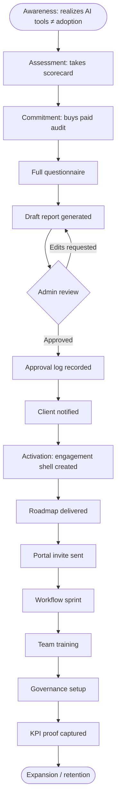

# FlashFusion User Flow — Agency Leads / Small B2B Teams

- **Owner:** Kyle Rosebrook / FlashFusion
- **Evidence classification:** HISTORICAL / UNVERIFIED (inherited from source; see `docs/DOCUMENTATION_STANDARDS.md`)
- **Source docs:** `flashfusion-export-v2/flashfusion-export-v2/product/personas.md` (`[RECONSTRUCTED]`),
  `product/user-flows.md` (`[RECONSTRUCTED]`), `product/journey-maps.md` (`[INFERRED]`) — all
  export date 2026-07-09
- **This document adds:** stitching the Prospect journey, core flows, and Client journey into a
  single per-persona sequence (`[INFERRED]` — the source docs describe these as separate,
  generic artifacts, not one persona-specific flow)

## Persona summary `[RECONSTRUCTED]`

> "Agency Leads / Small B2B Teams: need packaged AI delivery, team workflows, and proof."
> — `personas.md`, priority persona #2

## Flow chart

## Stage-by-stage narrative

| Stage | What the user does | System(s) touched | Source |
|---|---|---|---|
| Awareness → Assessment → Commitment | Prospect journey: realizes gap, takes scorecard, buys audit | Public site, scorecard | `journey-maps.md` "Prospect journey" `[EXACT]` |
| Full questionnaire → Draft report | Paid audit flow | Audit tool | `user-flows.md` core flow #2 `[EXACT]` |
| Admin review → Approval log → Client notification | Backstage step, not performed by this persona but gates their report | Admin/operator tooling | `user-flows.md` core flow #4 `[EXACT]`; this is the Operator journey's "triage audits / approve reports" step surfacing into the client-facing flow — cross-reference is `[INFERRED]` |
| Engagement shell → Roadmap → Portal invite | Client onboarding | Client portal | `user-flows.md` core flow #3 `[EXACT]` |
| Discovery → Roadmap → Workflow sprint → Training → Governance → KPI proof → Expansion/handoff | Full client journey | Client portal, delivery team | `journey-maps.md` "Client journey" `[EXACT]`; mapped onto this specific persona is `[INFERRED]` |

## Assumptions / inferred connections

- The source docs give three separate artifacts (a generic prospect journey, six generic core
  flows, and a generic client journey) but never explicitly say "this is the Agency Lead's
  flow." The sequencing above — prospect journey leads into the paid-audit core flow, which
  leads into the client journey — is the most direct reading given this persona's stated need
  ("packaged AI delivery, team workflows, and proof"), but it is new synthesis, not a quote.
  **`[REQUIRES CONFIRMATION]`** from the doc owner.
- "Team workflows" (plural, per the persona's own description) suggests the workflow sprint
  stage may repeat per team/workflow rather than running once — the source docs do not specify
  cardinality, so this chart shows it as a single pass. `[MISSING]`.

## Non-goals

- Does not specify pricing, contract terms, or SLA commitments.
- Does not confirm live system behavior — per the source docs' own caveat, "live
  Base44/Supabase/Stripe/n8n state may differ."
