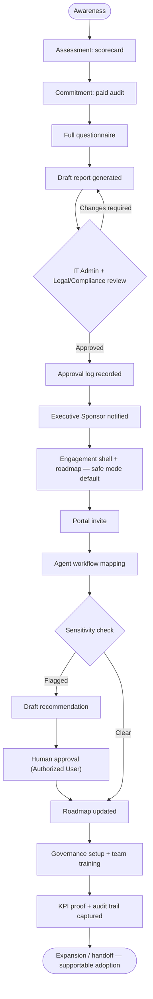

# FlashFusion User Flow — MSP-adjacent / Enterprise Clients

- **Owner:** Kyle Rosebrook / FlashFusion
- **Evidence classification:** HISTORICAL / UNVERIFIED (inherited from source; see `docs/DOCUMENTATION_STANDARDS.md`)
- **Source docs:** `flashfusion-export-v2/flashfusion-export-v2/product/personas.md` (`[RECONSTRUCTED]`),
  `product/user-flows.md` (`[RECONSTRUCTED]`), `product/journey-maps.md` (`[INFERRED]`) — all
  export date 2026-07-09
- **This document adds:** overlaying the PRD role list onto the Client journey's governance
  stage, and featuring the agent-workflow-mapping flow as the primary governed path
  (`[INFERRED]` — the source docs list PRD roles and the agent-workflow flow separately, without
  binding them to this persona or to each other)

## Persona summary `[RECONSTRUCTED]`

> "MSP-adjacent / Enterprise Clients: need safe adoption, governance, training, and
> supportability." — `personas.md`, priority persona #3

> "PRD roles: Operations Manager, Legal/Compliance Officer, HR Specialist, Finance Controller,
> IT Admin, Executive Sponsor, and Authorized User." — `personas.md`

Per the "Persona rule": safe mode is the *default* for non-technical users, and this persona's
stated need ("safe adoption") is read as this persona defaulting to safe mode, unlike the Solo
Operator persona `[INFERRED]`.

## Flow chart

## Stage-by-stage narrative

| Stage | What the user does | Role(s) involved | Source |
|---|---|---|---|
| Awareness → Assessment → Commitment | Prospect journey | Any prospect contact | `journey-maps.md` "Prospect journey" `[EXACT]` |
| Full questionnaire → Draft report | Paid audit | Operations Manager (typical intake contact) | `user-flows.md` core flow #2 `[EXACT]`; role attribution `[INFERRED]` |
| Review gate | Report is checked before the client sees it | IT Admin, Legal/Compliance Officer | `personas.md` PRD roles `[EXACT]` names; binding them to this gate is `[INFERRED]` |
| Notification | Sponsor is informed once approved | Executive Sponsor | `personas.md` PRD roles `[EXACT]` name; placement `[INFERRED]` |
| Engagement shell → Roadmap → Portal invite | Client onboarding, safe-mode default | — | `user-flows.md` core flow #3 `[EXACT]`; "safe mode default" applied here is `[INFERRED]` from the Persona rule |
| Agent workflow mapping → Sensitivity check → Draft recommendation → Human approval → Roadmap update | Governed AI-workflow change path | Authorized User | `user-flows.md` core flow #6 `[EXACT]`; featuring it as this persona's primary governed path is `[INFERRED]` |
| Governance + training → KPI proof → Expansion/handoff | Rest of client journey | Finance Controller, HR Specialist (governance/training stakeholders) | `journey-maps.md` "Client journey" `[EXACT]`; role attribution `[INFERRED]` |

## Assumptions / inferred connections

- `personas.md` lists PRD roles as a flat set without saying which role gates which stage. The
  role-to-stage assignments above are a plausible reading (compliance/IT gate the report;
  finance/HR own governance and training) but are **`[REQUIRES CONFIRMATION]`**, not fact.
- The security baseline in the source docs ("Agents cannot self-escalate permissions and cannot
  perform external side effects without approval") is the basis for showing every
  agent-workflow branch terminating in a human-approval node — this is a direct
  policy-to-diagram translation, not new invention, but the diagram is still `[INFERRED]`
  structure around an `[EXACT]` policy statement.

## Non-goals

- Does not specify actual RLS policies, audit-log schema, or specific compliance framework
  (e.g. SOC 2, HIPAA) — none is named in the source docs for this persona.
- Does not confirm live system behavior — per the source docs' own caveat, "live
  Base44/Supabase/Stripe/n8n state may differ."
