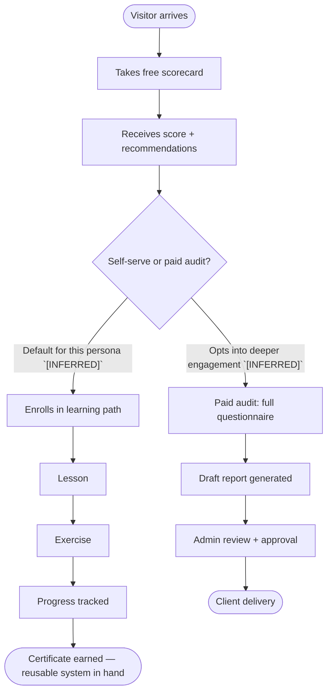

# FlashFusion User Flow — Solo Operators + AI-Native Builders

- **Owner:** Kyle Rosebrook / FlashFusion
- **Evidence classification:** HISTORICAL / UNVERIFIED (inherited from source; see `docs/DOCUMENTATION_STANDARDS.md`)
- **Source docs:** `flashfusion-export-v2/flashfusion-export-v2/product/personas.md`,
  `flashfusion-export-v2/flashfusion-export-v2/product/user-flows.md` (both `[RECONSTRUCTED]`,
  export date 2026-07-09)
- **This document adds:** persona-to-flow-stage mapping (`[INFERRED]` — not stated directly in
  either source doc)

## Persona summary `[RECONSTRUCTED]`

> "Solo Operators + AI-Native Builders: need fast practical wins and reusable systems."
> — `personas.md`, priority persona #1

Per the source doc's "Persona rule," every persona gets a different explanation level,
dashboard, risk language, and next action; safe mode is the *default for non-technical users*
only — this persona is explicitly technical/AI-native, so the flow below assumes the
non-safe-mode, faster-path experience `[INFERRED]`.

## Flow chart

## Stage-by-stage narrative

| Stage | What the user does | System(s) touched | Source |
|---|---|---|---|
| Visitor arrives | Lands on site, no commitment yet | Public site | `user-flows.md` core flow #1 `[EXACT]` |
| Free scorecard | Answers scorecard questions | Scorecard tool | `user-flows.md` core flow #1 `[EXACT]` |
| Score + recommendations | Receives score and next-action recommendations | Scorecard tool | `user-flows.md` core flow #1 `[EXACT]` |
| **Branch point** | Chooses self-serve build vs. paid audit | — | `[INFERRED]` — persona goal ("fast practical wins and reusable systems") implies self-serve is the primary path for this persona, not stated as a literal branch in source |
| Learning path (self-serve) | Lesson → exercise → progress → certificate | Learning platform | `user-flows.md` core flow #5 `[EXACT]`; routing this persona here is `[INFERRED]` |
| Paid audit (secondary path) | Full questionnaire → draft report → admin approval → delivery | Audit tool, admin review | `user-flows.md` core flow #2 `[EXACT]`; available to this persona but secondary is `[INFERRED]` |

## Assumptions / inferred connections

- The source docs never state that Solo Operators specifically default to the self-serve
  learning path rather than the paid-audit path — this is inferred from the persona's stated
  need ("fast practical wins and reusable systems") combined with the "Persona rule" (different
  next action per persona). **`[REQUIRES CONFIRMATION]`** from the doc owner before treating this
  as a production routing decision.
- No UI, copy, or dashboard mockup for this persona was found in the repo at the time of writing
  — this chart is a logical flow, not a wireframe.

## Non-goals

- Does not specify actual UI copy, screen layouts, or conversion funnel metrics.
- Does not confirm live system behavior (Base44/Supabase/Stripe/n8n) — per the source docs'
  own caveat, "live state may differ."
