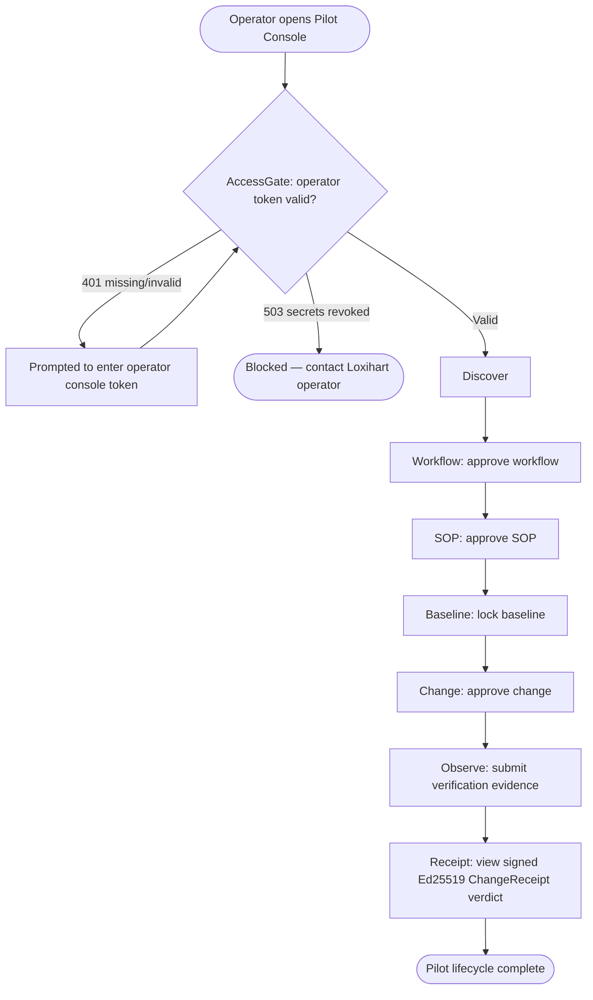

# Loxihart Pilot Flow — Reference Only

> **This is not a FlashFusion document and carries no product-planning authority.**
> Loxihart is owned and operated externally by `ChaosClubCo/Loxihart`. `loxihart/` in this repo
> is frozen historical/reference material per root `AGENTS.md`. This document describes
> existing, already-committed frozen behavior for context only. It introduces no new Loxihart
> product or UX decisions, is not authoritative, and must not be used to plan new Loxihart work
> from this repository.

- **Owner (of the underlying product):** ChaosClubCo/Loxihart (external)
- **Owner (of this reference doc):** Kyle Rosebrook / Abstrekkt (documentation only)
- **Evidence classification:** HISTORICAL (describes frozen code as committed; not a verified
  runtime/operational claim — see `docs/DOCUMENTATION_STANDARDS.md`)
- **Source:** `loxihart/pilot-console/src/App.tsx` (`STAGES` const), `AccessGate.tsx`,
  `loxihart/control-api/README.md`, `loxihart/canonical-truth/README.md`,
  `loxihart/change-receipt/README.md`, `docs/loxihart/CANONICAL_STATE.md`

## Role name is inferred

No file in `loxihart/` documents a named persona or role for who uses `pilot-console`. The only
human-role-flavored term found is **"operator"**, used as a credential label:

> "Unlock form shown when the Control API proxy rejects the caller (401) or when operator
> secrets are missing/revoked (503)." — `AccessGate.tsx`, comment
> "Enter the operator console token for this environment." — `AccessGate.tsx`, UI copy

The role name **"Pilot Operator"** used in this document is `[INFERRED]` from that credential
label and from the gated, approval-driven UX described below — not a documented persona.

## What pilot-console is, functionally

Explicitly stated: `control-api/README.md` describes `control-api` as the "Server-authoritative
API for the Loxihart Pilot Console." No `README.md` exists in `pilot-console/` itself.

Inferred from code structure (`App.tsx`): it is a single-page app with no router — one screen
stepping a single client's pilot through a 7-stage lifecycle rail defined in the `STAGES`
constant: **Discover → Workflow → SOP → Baseline → Change → Observe → Receipt**.

## Flow chart

## Stage-by-stage narrative

| Stage | What the operator does | Backing service | Source |
|---|---|---|---|
| AccessGate | Enters operator console token; blocked on 401/503 | `control-api` (rejects unauthenticated callers) | `AccessGate.tsx` `[EXACT]` |
| Discover | First stage of the pilot lifecycle rail | `control-api` `/v1/pilots/:pilotId/...` routes | `App.tsx` `STAGES` const `[EXACT]`; action label is `[INFERRED]` from surrounding approval-driven UX |
| Workflow | Approves the client's workflow | `control-api` | `STAGES` const `[EXACT]`; "approve" action `[INFERRED]` |
| SOP | Approves the SOP | `control-api` | `STAGES` const `[EXACT]`; "approve" action `[INFERRED]` |
| Baseline | Locks a measurement baseline | `control-api`, `canonical-truth` (mutation gate) | `STAGES` const `[EXACT]`; "lock" action `[INFERRED]` |
| Change | Approves one process change | `control-api`, `canonical-truth` | `STAGES` const `[EXACT]`; "approve" action `[INFERRED]` |
| Observe | Submits observation/verification evidence | `control-api` | `STAGES` const `[EXACT]`; action `[INFERRED]` |
| Receipt | Views a signed Ed25519 `ChangeReceipt` verdict | `change-receipt` (schema/validator) | `STAGES` const `[EXACT]`; `change-receipt/README.md` describes the receipt as "signed, machine-verifiable evidence" `[EXACT]` |

## Backing services (non-user-facing)

These are not shown as flow nodes because they are backend-only, not something the operator
directly interacts with:

- **`control-api`** — "Server-authoritative API for the Loxihart Pilot Console" (`control-api/README.md`)
- **`canonical-truth`** — "the sole mutation entrypoint," gating any canonical-state write behind
  a verified Ed25519 acceptance result (`canonical-truth/README.md`)
- **`change-receipt`** — defines/validates the frozen `loxihart.change-receipt.v1` schema
  (`change-receipt/README.md`); frozen 2026-08-16 per `change-receipt/FROZEN.json`

## Non-goals

- Does not describe the target architecture beyond what is already implemented — per
  `docs/loxihart/CANONICAL_STATE.md`, "only implemented/repository-backed components may be
  described as live."
- Does not propose any change to Loxihart's flow, UI, or roles. Any such change belongs in
  `ChaosClubCo/Loxihart`.
